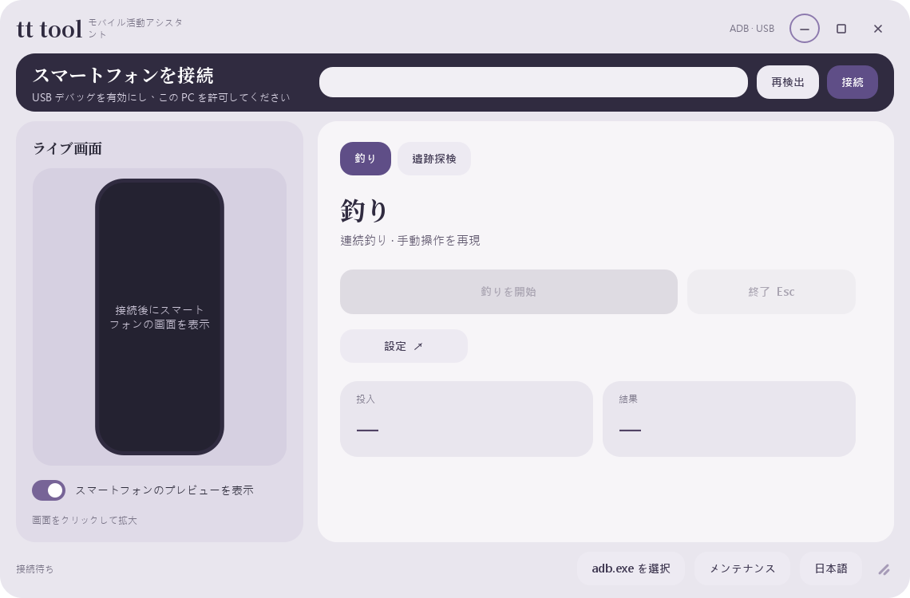
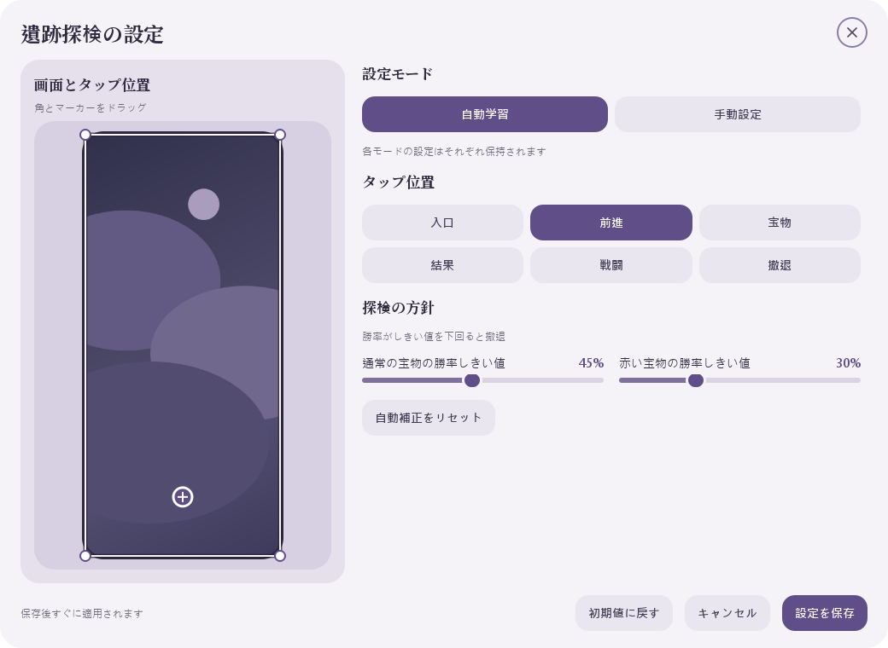

# tt tool

[English](README.md) · [繁體中文](README.zh-TW.md) · [한국어](README.ko.md)

tt tool は、Android 版『Clash of Critters』の釣りと遺跡探検を Windows から操作するツールです。USB 経由でスマートフォンの画面をプレビューし、PC 上で画面を認識します。アクティビティを選んで開始すると、スマートフォンへの入力が始まります。

**[Windows x64 インストーラーをダウンロード](https://github.com/Estrella-071/tt-tool/releases/download/v1.1.0/tt-tool-1.1.0-windows-x64-setup.exe)** · [v1.1.0 のリリースノートとチェックサム](https://github.com/Estrella-071/tt-tool/releases/tag/v1.1.0)



## インストールと使い方

1. Windows 10 22H2 または Windows 11（x64）でインストーラーを実行し、言語を選びます。Python と Qt はインストーラーに含まれています。初回インストール時は、インストール先を変更できます。スタートメニューのショートカットは既定で選択されており、デスクトップのショートカットは必要に応じて追加できます。インストール完了時に **tt tool** を起動するか選べます。初回起動時はインストール時に選択した言語で表示されます。
2. [Android SDK Platform-Tools](https://developer.android.com/tools/releases/platform-tools) と [FFmpeg](https://ffmpeg.org/download.html#build-windows) を導入します。実行ファイルが入ったフォルダーをユーザーの `Path` に追加し、新しい PowerShell で `adb version` と `ffmpeg -version` が実行できることを確認します。ADB は画面下部の **adb.exe を選択** から指定することもできます。`Path` を変更したら tt tool を開き直してください。
3. Android で USB デバッグを有効にし、データ通信に対応した USB ケーブルで PC と接続します。スマートフォンに表示される確認画面でデバッグを許可します。許可済みの端末が 1 台なら自動で接続されます。複数台の場合は端末を選んで **接続** を押します。
4. スマートフォンを縦向きにし、ゲームを前面に出して、釣りまたは遺跡探検の画面を表示します。プレビューで画面全体を確認し、**釣りを開始** または **探検を開始** を押します。tt tool のウィンドウにフォーカスがあるときは、スペースキーで開始、一時停止、再開ができ、Esc で終了できます。表示言語は右下のボタンで切り替えます。

ショートカットをどちらも追加しなかった場合は、インストール先の **tt tool** ショートカットから起動できます。

## アクティビティと設定

- **釣り**では、投入、アタリ、黄色のタイミングバー、結果画面を認識します。画面が切り替わらないときは、再度操作できる画面かを確認してから再試行します。連続釣りを選ぶか、投入回数と時間に上限を設定できます。
- **遺跡探検**では、進行、ボス戦の選択、宝箱、結果画面を認識します。合計勝率が標準では **45%** 未満、赤い宝物の場合は **30%** 未満で撤退します。しきい値は個別に変更できます。基本勝率と仲間のボーナスが表示される場合は、両方を合算します。複数フレームを確認してもボス戦の判断がつかない場合は、少し待ってから戦闘を選択します。
- **自動学習**は、認識を確認できた操作部品を使って位置を調整します。範囲や位置を自分で決める場合は **手動設定** に切り替え、プレビューの角や操作点をドラッグします。各モードの設定は個別に保存されます。



*設定画像にはサンプルを使用しています。認識は端末、映像の遅延、ゲーム画面のレイアウトによって変わります。詳細は [ADB スマートフォンガイド（繁体字中国語）](docs/ADB.md) を参照してください。*

## 更新とメンテナンス

ウィンドウ下部の **メンテナンス** から、GitHub の最新リリースを手動で確認したり、アプリのフォルダーやデータの保存先を開いたりできます。更新がある場合は確認後にブラウザーでリリースページが開くので、インストーラーをダウンロードして実行してください。

Windows インストーラーで導入した場合は、このメニューからアンインストールも開始できます。更新やアンインストールを行ってもユーザーデータは残ります。詳しくは [Windows インストールガイド（英語）](docs/INSTALLER.md) を参照してください。

## トラブル対処とローカルデータ

- **スマートフォンが表示されない**場合は、`adb devices` で状態が `device` になっているか確認します。`unauthorized` と表示される場合は、スマートフォンのロックを解除して、この PC での USB デバッグを許可してください。機種によってはメーカー提供の Windows 用 USB ドライバーが必要です。
- **接続済みでも画面が表示されない**場合は、`ffmpeg -version` が実行できるか確認し、スマートフォンを縦向きにしてロックを解除した状態で再接続します。黒枠や表示の欠けがある場合は、設定でゲームの範囲を調整してください。
- インストール版の設定、補正データ、診断ログは `%LOCALAPPDATA%\tt-tool\data` に保存されます。アンインストール後もこのデータは残ります。画面は PC 上で処理され、自動アップロードは行いません。[ローカルデータの説明](docs/PRIVACY.md)

## ソースコードからの起動と開発

開発には Windows、Git、Python 3.12 を使用します。上の手順で ADB と FFmpeg を準備し、PowerShell で以下を実行します。

```powershell
git clone https://github.com/Estrella-071/tt-tool.git
cd tt-tool
py -3.12 -m venv .venv
.\.venv\Scripts\python.exe -m pip install -r requirements.txt
.\.venv\Scripts\python.exe qt_fishing.py
```

| ファイル・フォルダー | 役割 |
| --- | --- |
| [`qt_fishing.py`](qt_fishing.py)、[`fisher/visual_settings.py`](fisher/visual_settings.py) | Qt ウィンドウ、言語切り替え、画面上での設定 |
| [`fisher/adb.py`](fisher/adb.py) | ADB による画面取得と入力送信、FFmpeg による映像のデコード |
| [`fisher/phone_vision.py`](fisher/phone_vision.py)、[`fisher/ruins.py`](fisher/ruins.py) | スマートフォンの画面認識と遺跡探検での判断 |
| [`tests/`](tests/) | 匿名化済みのテスト素材とオフライン回帰テスト |

`.\.venv\Scripts\python.exe selfcheck.py` でオフライン回帰テストを実行します。Windows インストーラーを再作成する場合は [ビルドと検証手順](docs/INSTALLER.md) を参照してください。旧エミュレーターモードの手順は [エミュレーターマニュアル](docs/EMULATOR.md) にあります。

## 貢献

[Issues](https://github.com/Estrella-071/tt-tool/issues) にはリリース番号、Windows と Android のバージョン、アクティビティ、再現手順、結果を記載してください。画像やログを共有する前に、端末のシリアル番号、プレイヤー情報、チャット、個人のファイルパスを取り除いてください。

Pull Request では、変更した動作と確認方法を説明してください。認識を修正する場合は、可能であれば匿名化した画像と回帰テストを追加してください。画面の文言を追加するときは、[翻訳テーブル](fisher/i18n.py) を更新して 4 言語を確認してください。

ソースコードのライセンスは [GPL-3.0-only](LICENSE) です。出典、サードパーティーのライセンス、ゲーム画像の権利については [NOTICE](NOTICE.md) を参照してください。利用前に対象ゲームとサービスの規則を確認してください。
