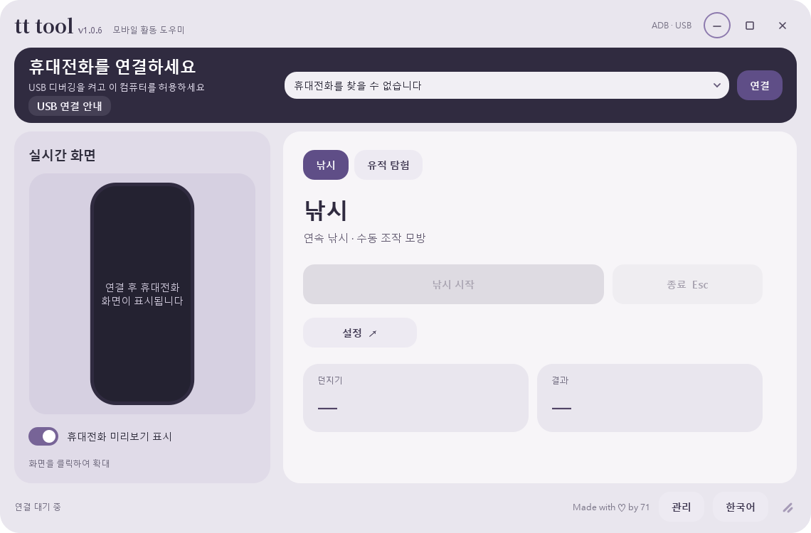
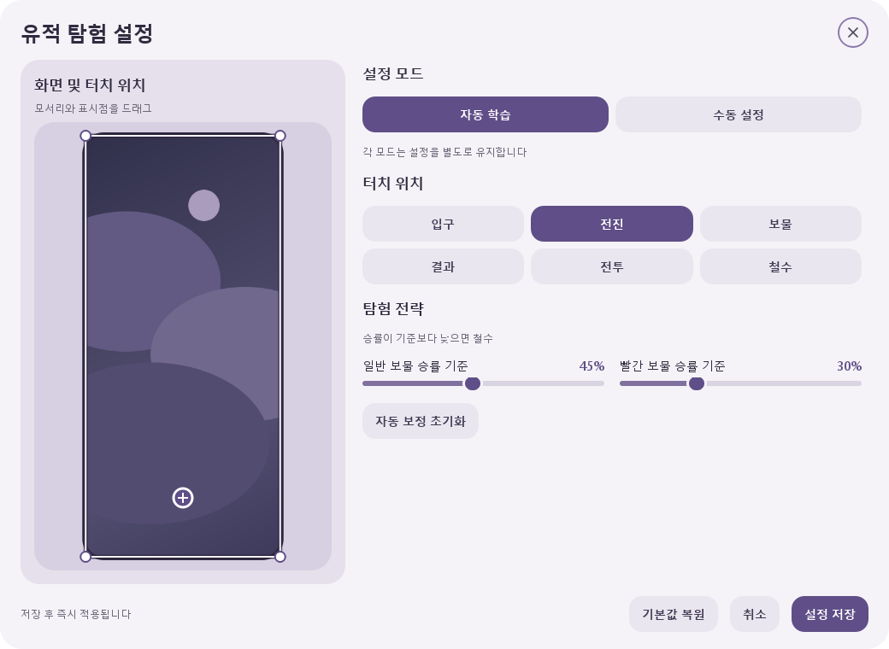

# tt tool

[English](README.md) · [繁體中文](README.zh-TW.md) · [日本語](README.ja.md)

tt tool은 Android용 Clash of Critters의 낚시와 유적 탐험을 Windows에서 조작하는 도구입니다. USB로 연결한 휴대전화 화면을 미리 보고, PC에서 화면을 인식합니다. 활동을 선택하고 시작을 누르면 휴대전화에 입력을 보냅니다.

**[Windows x64 설치 프로그램 다운로드](https://github.com/Estrella-071/tt-tool/releases/download/v1.0.6/tt-tool-1.0.6-windows-x64-setup.exe)** · [v1.0.6 릴리스 노트 및 체크섬](https://github.com/Estrella-071/tt-tool/releases/tag/v1.0.6)



## 설치 및 시작

1. Windows 10 22H2 또는 Windows 11(x64)에서 설치 프로그램을 실행하고 언어를 선택합니다. 설치 프로그램에 Python과 Qt가 포함되어 있습니다. 처음 설치할 때는 설치 위치를 바꿀 수 있습니다. 시작 메뉴 바로 가기는 기본으로 선택되며 바탕 화면 바로 가기는 필요할 때 선택할 수 있습니다. 설치를 마치면 **tt tool**을 바로 실행할지 선택할 수 있습니다. 앱은 처음 실행할 때 설치 중 선택한 언어로 표시됩니다.
2. [Android SDK Platform-Tools](https://developer.android.com/tools/releases/platform-tools)와 [FFmpeg](https://ffmpeg.org/download.html#build-windows)를 설치합니다. 실행 파일을 찾을 수 없으면 기기 메뉴의 **연결 도구**에서 파일을 지정한 뒤 **확인하고 다시 시도**를 선택하세요.
3. 앱의 **USB 연결 안내**나 [제조사별 안내](docs/USB-DEBUGGING.ko.md)에서 USB 디버깅을 켜고 파일 전송을 지원하는 USB 케이블로 PC에 연결합니다. 휴대전화에 나타나는 디버깅 요청을 승인합니다. 승인된 휴대전화가 한 대이면 자동으로 연결됩니다. 여러 대라면 기기를 선택한 다음 **연결**을 누릅니다.
4. 휴대전화를 세로로 두고 게임을 전면에 표시한 다음, 낚시 또는 유적 탐험 화면을 엽니다. 미리보기에서 전체 화면이 보이는지 확인하고 **낚시 시작** 또는 **탐험 시작**을 누릅니다. tt tool 창에 포커스가 있을 때 스페이스바로 시작, 일시 정지, 재개를 할 수 있고, Esc로 세션을 종료할 수 있습니다. 언어는 오른쪽 아래 버튼에서 변경합니다.

두 바로 가기를 모두 선택하지 않았다면 설치 폴더 안의 **tt tool** 바로 가기로 실행할 수 있습니다.

## 활동 선택 및 설정

- **낚시**는 낚싯대 던지기, 입질, 노란 타이밍 바와 결과 화면을 인식합니다. 화면이 바뀌지 않으면 조작 가능한 상태가 유지되는지 확인한 후 다시 시도합니다. 연속 낚시를 켜거나 던지기 횟수와 시간에 한도를 둘 수 있습니다.
- **유적 탐험**은 진행, 보스전 선택, 상자 및 결과 화면을 인식합니다. 기본적으로 합산 승률이 **45%** 미만이면 철수하고, 빨간 보물의 경우 **30%** 미만이면 철수합니다. 두 기준은 각각 조정할 수 있습니다. 기본 승률과 팀원 보너스가 표시되면 둘을 더합니다. 여러 프레임을 확인해도 보스전 결정을 내릴 수 없으면 잠시 기다렸다가 전투를 선택합니다.
- **자동 학습**은 확인된 조작 요소를 기준으로 위치를 조정합니다. 영역과 위치를 직접 지정하려면 **수동 설정**으로 전환한 뒤 미리보기의 모서리와 조작 지점을 끌어 놓습니다. 두 모드의 설정은 별도로 저장됩니다.



*설정 화면에 예시 이미지를 사용했습니다. 인식 결과는 휴대전화, 영상 지연, 게임 화면 구성의 영향을 받습니다. 자세한 내용은 [ADB 휴대전화 가이드](docs/ADB.ko.md)를 참고하세요.*

## 업데이트 및 관리

창 하단의 **관리 → 업데이트 확인**을 선택합니다. v1.0.5 이상 설치 버전에서는 앱 안에서 새 버전을 다운로드해 검증하고, 확인 후 기존 위치에 업데이트할 수 있습니다.

앱에 v1.1.0, v1.2.0, v1.3.0 중 하나가 표시되면 tt tool을 닫고 v1.0.6 설치 프로그램을 한 번 실행하세요. 설정은 유지됩니다. 직접 내려받으려면 **릴리스 페이지 열기**를 선택하세요.

**관리** 메뉴에서 앱 또는 데이터 폴더를 열고 앱 제거를 시작할 수 있습니다. 제거 확인 화면에는 설치 위치가 표시됩니다. 업데이트와 기본 제거 과정에서는 데이터를 유지합니다. 데이터까지 지우려면 **tt tool 로컬 데이터도 삭제**를 선택하세요. 설치 프로그램에 디지털 서명이 없어 Windows에 ‘알 수 없는 게시자’로 표시될 수 있습니다. [Windows 설치 안내](docs/INSTALLER.ko.md)

## 문제 해결 및 로컬 데이터

- **휴대전화가 표시되지 않는 경우**. `adb devices`에서 상태가 `device`인지 확인합니다. `unauthorized`로 표시되면 휴대전화 잠금을 해제하고 이 PC의 USB 디버깅을 허용합니다. 기종에 따라 제조사의 Windows USB 드라이버가 필요할 수 있습니다.
- **연결됐지만 미리보기가 비어 있는 경우**. `ffmpeg -version`이 실행되는지 확인한 뒤, 휴대전화 잠금을 해제하고 세로 화면으로 유지한 상태에서 다시 연결합니다. 검은 테두리가 있거나 화면이 잘리면 설정에서 게임 화면 영역을 조정합니다.
- 설치 버전은 설정, 보정 데이터, 진단 로그를 `%LOCALAPPDATA%\tt-tool\data`에 저장합니다. 프로그램을 제거할 때 기본적으로 데이터가 유지됩니다. 화면은 PC에서 처리되며 자동으로 업로드되지 않습니다. [로컬 데이터 안내](docs/PRIVACY.ko.md)

## 소스에서 실행 및 개발

개발 환경에는 Windows, Git, Python 3.12가 필요합니다. 위의 방법으로 ADB와 FFmpeg를 준비한 뒤 PowerShell에서 다음 명령을 실행합니다.

```powershell
git clone https://github.com/Estrella-071/tt-tool.git
cd tt-tool
py -3.12 -m venv .venv
.\.venv\Scripts\python.exe -m pip install -r requirements.txt
.\.venv\Scripts\python.exe qt_fishing.py
```

| 경로 | 역할 |
| --- | --- |
| [`qt_fishing.py`](qt_fishing.py), [`fisher/visual_settings.py`](fisher/visual_settings.py) | Qt 창, 언어 전환 및 시각적 설정 |
| [`fisher/adb.py`](fisher/adb.py) | ADB 화면 캡처와 입력 전송, FFmpeg 영상 디코딩 |
| [`fisher/phone_vision.py`](fisher/phone_vision.py), [`fisher/ruins.py`](fisher/ruins.py) | 휴대전화 화면 인식 및 유적 탐험 판단 |
| [`tests/`](tests/) | 개인 식별 정보를 제거한 테스트 자료 및 오프라인 회귀 테스트 |

`.\.venv\Scripts\python.exe selfcheck.py`로 오프라인 회귀 테스트를 실행합니다. Windows 설치 프로그램을 다시 빌드하려면 [설치 프로그램 빌드 및 검증 안내](docs/INSTALLER.ko.md)를 참고하세요. 이전 에뮬레이터 모드의 절차는 [에뮬레이터 설명서](docs/EMULATOR.ko.md)에 있습니다.

## 기여하기

[Issues](https://github.com/Estrella-071/tt-tool/issues)에 릴리스, Windows 버전, Android 버전, 활동, 재현 절차 및 실제 동작을 적어 주세요. 스크린샷이나 로그를 공유하기 전 기기 일련번호, 플레이어 정보, 채팅 및 개인 경로를 지워 주세요.

Pull Request에는 변경된 동작과 테스트 방법을 설명해 주세요. 화면 인식 수정에는 가능한 경우 개인 식별 정보를 제거한 자료와 회귀 테스트를 추가합니다. 화면 문구를 추가할 때는 [번역 테이블](fisher/i18n.py)을 업데이트하고 네 가지 언어를 확인합니다.

소스 코드는 [GPL-3.0-only](LICENSE)를 따릅니다. 출처, 서드파티 라이선스, 게임 이미지 권리는 [NOTICE](NOTICE.ko.md)를 참고하세요. 도구를 사용하기 전 해당 게임과 서비스의 규칙을 확인하세요.
