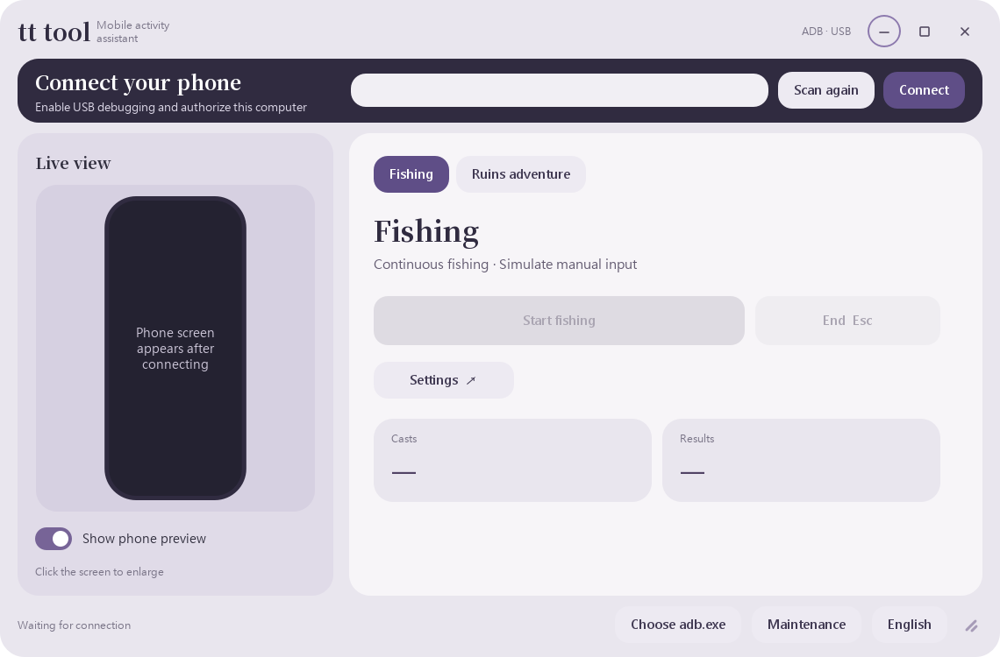
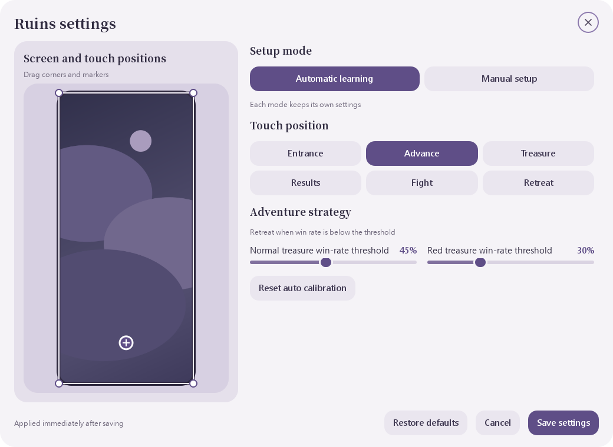

# tt tool

[繁體中文](README.zh-TW.md) · [日本語](README.ja.md) · [한국어](README.ko.md)

tt tool is a Windows companion for fishing and Ruins Adventure in Clash of Critters on Android. It previews the phone over USB and recognizes activity screens locally. Phone input begins after you select an activity and start a session.

**[Download the Windows x64 installer](https://github.com/Estrella-071/tt-tool/releases/download/v1.1.0/tt-tool-1.1.0-windows-x64-setup.exe)** · [v1.1.0 release notes and checksums](https://github.com/Estrella-071/tt-tool/releases/tag/v1.1.0)



## Install and get started

1. Run the installer on Windows 10 22H2 or Windows 11 (x64) and choose a language. The installer includes Python and Qt. On a first install, you can change the installation folder. The Start menu shortcut is selected by default, and the desktop shortcut is optional. Choose whether to open **tt tool** when setup finishes. On first launch, the app uses the language you selected during setup.
2. Install [Android SDK Platform-Tools](https://developer.android.com/tools/releases/platform-tools) and [FFmpeg](https://ffmpeg.org/download.html#build-windows). Add the folders containing their executables to your user `Path`, then run `adb version` and `ffmpeg -version` in a fresh PowerShell window. You can also use **Choose adb.exe** at the bottom of tt tool to point to ADB. Reopen tt tool after changing `Path`.
3. Enable USB debugging on Android, connect the phone with a USB data cable and approve the debugging prompt. tt tool connects automatically when exactly one authorized phone is present. If you have several, select one and choose **Connect**.
4. Keep the phone in portrait orientation and bring the appropriate fishing or ruins screen to the foreground. Check that the preview shows the whole screen and choose **Start fishing** or **Start exploring**. With the tt tool window focused, Space starts, pauses or resumes the activity, and Esc ends the session. Use the button at the bottom right to change the interface language.

If you skip both shortcuts, open the **tt tool** shortcut inside the installation folder.

## Choose an activity and adjust settings

- **Fishing** recognizes casting, bites, the yellow timing bar and results. When a screen change is missed, tt tool checks that the action screen is stable before retrying. Choose continuous fishing or set a cast and time limit.
- **Ruins adventure** recognizes progress screens, boss decisions, chests and results. By default, it retreats below a total win chance of **45%**, or **30%** for red treasure. The two thresholds can be adjusted separately. When the screen shows a base chance and teammate bonus, tt tool adds them. If it still cannot confirm a boss decision across several frames, it fights after a short wait.
- **Automatic learning** adjusts positions using confirmed controls. To specify your own region and positions, switch to **Manual setup**, then drag the corners and action points on the preview. The two modes save their settings separately.



*The settings screenshot uses a sample preview. Recognition depends on the phone, stream latency and game layout. See the [ADB mobile guide](docs/ADB.md) in Traditional Chinese for details.*

## Updates and maintenance

Open **Maintenance** at the bottom of the app to check for updates or open the app and data folders. Update checks run on request. If an update is available, confirm to open the release page in your browser, then download and run the installer.

The maintenance menu also offers uninstall when tt tool was installed with the Windows installer. Your data stays available after updating or uninstalling. See the [Windows installer guide](docs/INSTALLER.md).

## Troubleshooting and local data

- **Phone is missing**. Run `adb devices` and check for the `device` status. If it says `unauthorized`, unlock the phone and authorize USB debugging for this computer. Some phones also need the manufacturer's Windows USB driver.
- **Phone is connected but the preview is blank**. Check that `ffmpeg -version` works, make sure the phone is unlocked and in portrait orientation, then reconnect. Adjust the game region from Settings if the game is cropped or has black borders.
- The installed app stores settings, calibration and diagnostic logs in `%LOCALAPPDATA%\tt-tool\data`. Uninstalling keeps this data. Frames are processed locally and the app has no automatic uploads. See the [data guide](docs/PRIVACY.md).

## Run from source and develop

Use Windows, Git and Python 3.12 for development. Set up ADB and FFmpeg as above, then run these commands in PowerShell.

```powershell
git clone https://github.com/Estrella-071/tt-tool.git
cd tt-tool
py -3.12 -m venv .venv
.\.venv\Scripts\python.exe -m pip install -r requirements.txt
.\.venv\Scripts\python.exe qt_fishing.py
```

| Location | What it does |
| --- | --- |
| [`qt_fishing.py`](qt_fishing.py), [`fisher/visual_settings.py`](fisher/visual_settings.py) | Qt window, language selection and visual settings |
| [`fisher/adb.py`](fisher/adb.py) | Captures frames over ADB, decodes them with FFmpeg and dispatches input |
| [`fisher/phone_vision.py`](fisher/phone_vision.py), [`fisher/ruins.py`](fisher/ruins.py) | Mobile screen recognition and ruins decisions |
| [`tests/`](tests/) | Anonymized fixtures and offline regression tests |

Run `.\.venv\Scripts\python.exe selfcheck.py` for offline regression checks. See [building and verifying the installer](docs/INSTALLER.md) to reproduce the Windows installer. The [emulator manual](docs/EMULATOR.md) preserves the legacy workflow.

## Contribute

In an [issue](https://github.com/Estrella-071/tt-tool/issues), include the release, Windows and Android versions, activity, steps to reproduce and what happened. Remove device serial numbers, player details, chats and personal paths from screenshots or logs before sharing them.

Pull requests are welcome. Describe the behavior that changed and how you tested it. For a recognition fix, include an anonymized fixture and a regression case when possible. Update the [translation table](fisher/i18n.py) and check all four languages when adding interface text.

Source code is [GPL-3.0-only](LICENSE). See [NOTICE](NOTICE.md) for attribution, third-party notices and game image rights. Check the applicable game and service rules before using the tool.
