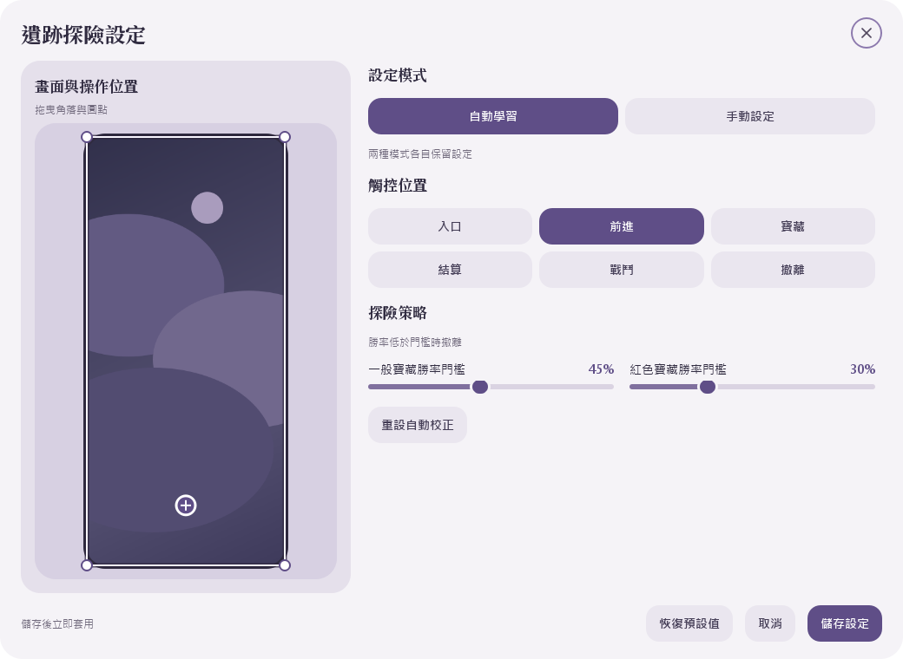

# tt tool

[English](README.en.md) · [日本語](README.ja.md) · [한국어](README.ko.md)

tt tool 是 Windows 上的 Android 手機活動助手，支援《塔塔冒險隊》（Clash of Critters）的釣魚與遺跡探險。透過 USB 連線預覽手機畫面，辨識在電腦上執行。選擇活動並按下開始後才會操作手機。

**[下載 Windows x64 安裝程式](https://github.com/Estrella-071/tt-tool/releases/download/v1.0.1/tt-tool-1.0.1-windows-x64-setup.exe)** · [v1.0.1 版本資訊與檔案校驗](https://github.com/Estrella-071/tt-tool/releases/tag/v1.0.1)


## 安裝與開始使用

1. 在 Windows 10 22H2 或 Windows 11（x64）開啟安裝程式並先選語言。安裝程式已包含 Python 與 Qt，完成後可從開始選單開啟 **tt tool**。工具首次開啟時會沿用安裝語言。
2. 安裝 [Android SDK Platform-Tools](https://developer.android.com/tools/releases/platform-tools) 和 [FFmpeg](https://ffmpeg.org/download.html#build-windows)。把兩者執行檔所在的資料夾加到使用者的 `Path`，開啟新的 PowerShell 執行 `adb version` 和 `ffmpeg -version` 確認。也可在工具下方按 **選擇 adb.exe** 指定 ADB 路徑。更新 `Path` 後請重開工具。
3. 在 Android 開啟 USB 偵錯，以支援資料傳輸的 USB 線連接電腦，並在手機上允許偵錯。工具會自動連線至唯一已授權的手機。有多台時，選好裝置後按 **連線手機**。
4. 將遊戲維持直向並切到前景，進入對應的釣魚或遺跡探險畫面。確認預覽完整後按 **開始釣魚** 或 **開始探險**。工具視窗中，空白鍵可開始、暫停及繼續，Esc 可結束。從右下方切換介面語言。

## 選擇活動與調整設定

- **釣魚**辨識下鉤、上鉤、黃條與結算畫面。畫面未如預期切換時，會重新確認可操作的狀態後再試。可選擇持續釣魚，或設定下鉤次數與時間上限。
- **遺跡探險**辨識前進、首領決策、寶箱與結算。預設總勝率低於 **45%** 時撤離，紅色寶藏則採 **30%**，兩種門檻可各自調整。畫面顯示基礎勝率與隊友加成時，會相加算出總勝率。多張畫面仍無法確認首領決策時，工具會在短暫等待後戰鬥。
- **自動學習**使用確認過的控件調整位置。需要指定範圍或位置時，切換至 **手動設定**，拖曳預覽上的角點與操作點。兩種設定分開儲存。



*設定畫面使用示意預覽。實際辨識會受手機、串流延遲及遊戲版面變化影響。詳細行為見 [ADB 手機模式](docs/ADB.md)。*

## 排查與本機資料

- **手機未出現**：執行 `adb devices` 並確認裝置顯示為 `device`。若顯示 `unauthorized`，解鎖手機並允許本機 USB 偵錯。部分手機也需要製造商提供的 Windows USB 驅動程式。
- **裝置已連線，畫面仍空白**：確認 `ffmpeg -version` 可執行，檢查手機直向且畫面未鎖定，再嘗試重新連線。黑邊或裁切可在設定中調整。
- 安裝版的設定、校正與診斷記錄存於 `%LOCALAPPDATA%\tt-tool\data`。解除安裝會保留資料。影像在本機處理，工具不會自動上傳。 [資料說明](docs/PRIVACY.md)

## 從原始碼執行與開發

開發環境使用 Windows、Git 與 Python 3.12。依照前述步驟準備 ADB 與 FFmpeg，再在 PowerShell 執行下列指令。

```powershell
git clone https://github.com/Estrella-071/tt-tool.git
cd tt-tool
py -3.12 -m venv .venv
.\.venv\Scripts\python.exe -m pip install -r requirements.txt
.\.venv\Scripts\python.exe qt_fishing.py
```

| 位置 | 用途 |
| --- | --- |
| [`qt_fishing.py`](qt_fishing.py)、[`fisher/visual_settings.py`](fisher/visual_settings.py) | Qt 主視窗、語言切換與圖形化設定 |
| [`fisher/adb.py`](fisher/adb.py) | 透過 ADB 擷取畫面、由 FFmpeg 解碼，並將輸入送回裝置 |
| [`fisher/phone_vision.py`](fisher/phone_vision.py)、[`fisher/ruins.py`](fisher/ruins.py) | 手機畫面的辨識與探險決策 |
| [`tests/`](tests/) | 去識別化測試素材與離線回歸測試 |

執行 `.\.venv\Scripts\python.exe selfcheck.py` 進行離線回歸。需要重建 Windows 安裝程式時，見 [安裝包建置與驗證](docs/INSTALLER.md)。舊版模擬器操作說明保存在 [模擬器手冊](docs/EMULATOR.md)。

## 貢獻

在 [Issues](https://github.com/Estrella-071/tt-tool/issues) 附上版本、Windows 與 Android 版本、活動、重現步驟和實際結果。若需要附畫面或記錄，請先遮蔽裝置序號、玩家資訊、聊天及個人路徑。

歡迎送出 Pull Request。說明修改的行為與驗證結果，辨識修正可附去識別化的測試畫面與回歸案例。新增介面文字時，請更新 [語系表](fisher/i18n.py) 並確認四種語言。

原始碼採 [GPL-3.0-only](LICENSE)。來源、第三方授權與遊戲畫面權利見 [NOTICE](NOTICE.md)。使用前請確認相關遊戲及服務規則。
