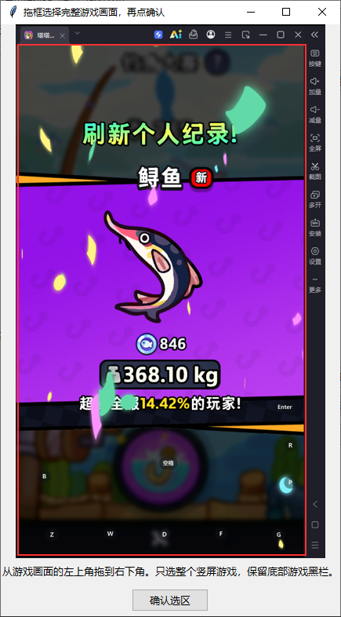

# シミュレーターモードオリジナル取扱説明書

[English](EMULATOR.md) · [繁體中文](EMULATOR.zh-TW.md) · 日本語 · [한국어](EMULATOR.ko.md)

> この技術資料には過去のバージョンと測定記録が含まれます。現在のセットアップと対応機能については[メインガイド](../README.ja.md)を参照してください。

このマニュアルには、シミュレータのエントリのための操作手順とタイミング手順が記載されています。モバイル版のインストールと使用方法については、[tttool](../README.ja.md).マニュアル内のバージョンおよびポータブルパッケージ名はエミュレータのバージョンに属します。

Windows 上の Raiden/MuMu エミュレータ用の Python 画像認識フィッシング ツール。スクリーンショット判定ステージを通じて、フック、プルフック、イエローバー判定、決済リターンはゲームメモリを読み込まずにスペースで完了します。

[GitHub プロジェクト ](https://github.com/Estrella-071/tt-tool) · [更新レコード ](../CHANGELOG.ja.md)

> このプロジェクトは学習とコミュニケーションのために無料で提供されます。ライセンス、アクティベーション コードを購入したり、ロックを解除するために料金を請求したりする必要はありません。上記のプロジェクトアドレスからソースコードを取得してください。

現在のバージョンは**1.6.1**です。 「連続釣り」はデフォルトでチェックされており、スクリーンショットは 6 参照フレームごと (約 10 回/秒) に撮影され、黄色のバー ボタンは連続的な往復動作のタイミングで予約されます。スクリーンショットは位置を修正するだけです。プレビューはデフォルトでは非表示になっており、トレース、スクリーンショット、実行ログ、診断 ZIP は自動的に保存されません。ソース コード配布パッケージには、完全なソース コードと必要なリソースが含まれています。 Windows インストール不要のパッケージには実行環境も付属しており、外側の「Start Phishing Assistant.bat」を使用して起動できます。
## 関数

- フッキング準備、フッキング待ち、フッキング引き、イエローバー判定、結果表示を自動識別。
- 黄色バーのスキップや連続ラウンドの黄色バー判定をサポートします。
- 通常の「ハッピーアクセプタンス」と、「チーム記録の更新」画面を含む青、紫、金色、赤オレンジのグラデーション記録決済ページをサポートします。
- 結果ページは、最初のキーの押下が受け付けられない場合のスタックを避けるために待機した後、スペースの再試行を続けます。
- ノンストップフィッシング、回数/期間制限、スクリーンショット間隔、ショートカットキーを設定可能です。
- デフォーカス一時停止、手動緊急一時停止、スクリーンショット、手動録画、オフライン再生。

## ダウンロードして起動する

新しいディレクトリに解凍し、元の Anaconda 環境または PyCharm で `main.py` を実行します。依存関係がすでにインストールされている場合は、環境を再インストールする必要はありません。アップグレードすると、古いディレクトリから `config.json` と `speed_profile.json` をコピーできます。最初のアップグレードでは、「釣りを続ける」をチェックし、古いデフォルトのスクリーンショット間隔の 30 を 6 に変更します。その他のカスタマイズされたスクリーンショット間隔、ショートカット キー、待機時間、速度パラメータは保持されます。アップグレード後に再度変更した設定は正常に保存されます。
ソース コード メソッドには、Windows、Python 3.10 以降、および次の依存関係が必要です。

```bash
python -m pip install -r requirements.txt
python main.py
```

PyCharm を使用する場合は、`main.py` を含むプロジェクト フォルダーを開き、対応するインタープリターを選択します。 Anaconda の依存関係がすでにインストールされている場合は、Anaconda を再インストールする必要はありません。ソース コードを実行するには Tkinter が必要です。インタプリタに含まれていない場合は、`tk` を対応する Conda 環境にインストールできます。ゲームの完全な垂直画面アスペクト比は約 336:598 です。

LDPlayer または MuMu のシミュレータとゲームは自分で準備する必要があります。依存関係を含む独自の配布パッケージを作成する必要がある場合は、[Windows Portable Edition Build](WINDOWS.ja.md);」を参照してください。現在のソース コード パッケージには、Python またはサードパーティの依存関係ファイルが含まれていません。

## スペースマッピングを設定する

シミュレータで、円形の釣りボタンの下半分が「Happy Take」ボタンと重なる場所にスペースをマッピングします。この位置は、両方のインターフェイスのボタン内に収まる必要があります。

それぞれ手動で確認します。スペースをフックしたり、引っ張ったり、黄色のバーの操作を完了したり、「ハッピーアクセプタンス」を閉じたり、決済ページを記録したりできます。プログラムは常にスペースのみを送信し、Enter キーを押すように自動的に変更されることはありません。チャット ボックスやその他のボタンにスペース マッピングを配置しないでください。

## ゲーム画面全体をフレームに収める

1. プログラムを実行し、手順 1 で「Thunder Simulator」または「MuMu Simulator」を選択し、対応するゲーム ウィンドウを選択します。
2. 「2. 完全なゲーム画面をフレーム化する」をクリックすると、3 秒以内にシミュレーターに戻ります。
3. ゲームの左上隅からスクリーンショットの右下隅までドラッグして、選択を確認します。

**完全な縦画面ゲーム領域のみを選択してください。シミュレータのタイトル バー、右側のツールバー、およびゲームの外側の黒い境界線は選択しないでください。下の黒いバーをゲーム内に保持します。 ** 魚、黄色のバー、または釣りボタンを枠で囲むだけでなく、上端、左端、右端、または下端のインターフェイスを省略しないでください。

下の図の赤枠が正しい例です。例は結果ページにあります。他の釣りステージでは同じ完全なゲーム選択が使用されています。この画像はプログラム内の「ビューフレーム選択例」でも開くことができます。



ウィンドウ リストは、選択したエミュレータのタイトルによってフィルタリングされ、マルチオープン マネージャはデフォルトのターゲットになりません。インスタンスがカスタム名を使用しており、リストに表示されない場合は、「他のウィンドウを表示」にチェックを入れて、実際にゲームを実行するウィンドウを手動で選択できます。シミュレータを切り替えた後、再確認して選択してください。異なるシミュレーターからの選択が混合されることはありません。 Thunderbolt と MuMu はどちらも、表示されるウィンドウのスクリーンショットと前景空間マッピングを使用し、ADB やゲーム ファイルの変更を必要としません。

シミュレータのウィンドウ サイズ、解像度、または表示比率を調整した後は、監視を停止して再選択する必要があります。プログラムはウィンドウを移動するときにのみその位置に従います。ゲームは視界を遮られずに維持されなければなりません。

## 開始と一時停止

1. 「釣りオプション」では、釣りを停止するかどうか、スクリーンショットの間隔、回数/分の上限を設定します。
2. 「3.設定を適用して監視をオンにする」をクリックします。現時点ではスクリーンショット認識のみが実行され、自動フィッシングはまだ利用できません。
3. シミュレータに戻るには、スタート ショートカット キーを押します。デフォルトは **F8** です。または、「4. 3 秒で釣りを開始」をクリックすると、すぐにシミュレーターに戻ります。
4. 上部に「自動的にスペースを押す・実行中」と表示されたら操作を開始します。

「観察のみ」はデフォルトではチェックされていません。チェックすると、認識結果のみが表示され、スペースは送信されません。ソフトウェアは開くたびに一時停止したままになり、単独では動作しません。

アシスタント、ブラウザ、またはその他のウィンドウをクリックすると、エミュレータはフォーカスを失い、一時停止します。シミュレータに戻った後は再起動が必要です。プロジェクト リンクをクリックするか、フレーム化されたサンプルを開いた場合も、操作は一時停止されます。プログラムを閉じるとバックグラウンド ループが停止し、プログラムによって押されたスペースが解放されます。

|機能 |デフォルトのショートカット キー |
|---|---|
|開始/一時停止 | F8 |
|緊急一時停止、3 秒スタートのキャンセル | F9 |
|ゲームのスクリーンショットを保存する | F10 |

「ショートカット キーと遅延」ページで、F1 から F12 までの他のキーに変更できます。 3 つのキーを繰り返すことはできません。変更前に監視を停止し、変更後に手順 3 で再度 [適用] をクリックします。インターフェイスには、シミュレータまたは他のソフトウェアのホットキーとの競合を避けるために、現在アクティブなキーが表示されます。

## ノンストップフィッシングとスクリーンショットの頻度

デフォルトでは「釣りを止めない」にチェックが入っており、最大回数や分数は影響しません。決済が完了したら次へお進みください。制限を元に戻すにはチェックを外します。釣りを再開するたびに、回数と時間が再計算されます。

連続モードでは、手動一時停止、焦点が合っていない、無反応な保護機能が引き続き維持され、未知のポップアップ ウィンドウや餌の購入や補充などのボタンを盲目的にクリックすることはありません。

[ショートカット キーと遅延] ページで、[未確認画面の待機時間] を設定できます。デフォルトは 60 秒です。 「黄色のバーのフェーズ待機」のデフォルトは 120 秒です。両方の項目の範囲は 0 ～ 3600 秒です。対応する自動タイムアウトをオフにするには、0 を入力します。画像が確認できない期間は観察のみでスペースの送信は行われません。 F9 キーと焦点外一時停止は引き続き有効です。古いバージョンの未確認待機時間が元のデフォルトの 12 秒のままである場合、アップグレード時に 60 秒に変更され、その他のカスタム値は保持されます。

「フレームごとのスクリーンショット」は 1 ～ 60 の整数を受け入れ、ゲームの内部フレーム番号を読み取ることなく、**每秒60个基准帧** に従って時間を変換します。

|入力値 |スクリーンショットの間隔 | 1 秒あたりのスクリーンショットの目標 |
|---:|---:|---:|
| 6 (デフォルト) | 100ミリ秒 | 10回 |
| 12 | 200ミリ秒 | 5回 |
| 30 | 500ミリ秒 | 2回 |
| 60 | 1000 ミリ秒 | 1回 |

認識応答速度を追求する場合は、より小さく調整できます。コンピューターがフリーズした場合は、スクリーンショットと認識のオーバーヘッドを減らすために、サイズを大きく調整できます。値を大きくすると、サンプリングが遅くなり、短いフック プロンプトを見逃しやすくなります。値が小さいほど、全体的な釣り効率が向上することは保証されません。黄色のバーのクリックでは別のピリオドが使用されるため、次のスクリーンショットを待つ必要はありません。ターゲットに近づくとき、またはキャリブレーションを実行するときに、追加のスクリーンショットは暗号化されません。インターフェイスには、実際のスクリーンショットの数が表示されます。プレビューはデフォルトでは非表示になっています。非表示の場合、注釈の描画とインターフェース画像の変換はスキップされます。キーの期限が近づくと、最初にキーが処理されてからスクリーンショットが撮影されます。実際のスクリーンショットの頻度は設定値よりも若干低くなる場合があります。

## 和解とイエローバー判定

結果ページで継続的に確認した後、デフォルトの待機時間は 3 秒で、スペースを押します。画面がまだ決済ページまたは「同意してください」を記録している場合、±40 ミリ秒のランダムな間隔で約 1 秒ごとに再試行されます。再試行回数に上限はありません。各操作は新しいスクリーンショットに基づいています。チェックアウト ページを離れた後に閉じるアクションを停止し、フックをクリックする前に最初のインターフェイスを確認します。システムの遅延やスクリーンショットの処理により、実際の間隔が長くなる可能性があります。

「ハッピーアクセプタンス」は、タイトル、緑色のボタン領域、指定された位置の白いテキスト、および暗い背景の組み合わせによって認識されます。テキストは狭い範囲のスケーリングを可能にし、緑色の陰影に依存することなく完全に一貫しています。記録ページは、重量アイコン、青/紫/金/赤-オレンジのグラデーションパネル、暗い背景の組み合わせによって識別され、魚の名前や「個人/チーム記録」のタイトルには依存しません。不明なインターフェイスではまだキーが押されません。記録ページと次のページの間の切り替えは、単一の決済プロセスを共有します。

黄色のバーの段階では、連続運動フェーズは一定の比例速度で維持されます。最初は右に、終了時点までは逆方向に、その後のスクリーンショットで位置を修正します。複数ラウンドの判定は、各ラウンドを開始点にリセットすることなく、前のラウンドの位置から継続されます。

魚浮きの中心が既に黄色の領域に入ったらすぐにボタンを押してください。まだ入っていない場合は、黄色のバーの中央を通過する次のクリック時間を予約します。これには、エンドポイントまでのルートと戻ってくるルートも含まれます。ターゲットが狭くても一定の安全マージンがあるため動作が停止することはありません。同じパスに対して押すことができるのは 1 回だけです。黄色のバーが次のラウンドに変わった後、もう一度ボタンを押すことができます。同じ黄色のバーが変化しない場合は、次のパスで再試行できます。

プレビューの緑色のボックスは黄色のターゲットを示し、赤色の線は魚の浮きを示し、紫色の線は予測有効位置を示します。タイミング原理と適用可能な境界については、[アルゴリズムの説明](ALGORITHM.ja.md)」を参照してください。

## 比例速度とキャリブレーション

「速度とキャリブレーション」ページには、デフォルトで基準速度 **60.6%条宽/秒** が表示されます。スケールの単位は、ジャッジメントバーの目に見える外枠の全幅です。フロート中心の実際のストロークから、左右のエンドキャップと装飾が差し引かれます。計算は元のデバイスのピクセル サイズには依存しません。

キャリブレーションのチェックを外すと、マシンの保存された速度が使用されます。マシンのパラメータがない場合は参考値を使用します。 「This Calibration Speed」にチェックを入れた後、通常のスクリーンショットでも同じ方向の変位間隔を使用してください。サンプリング間隔が 0.25 秒未満の場合、最初に同じ方向の変位間隔が累積され、次にゼロ変位、クロスエンドポイント、入力モーションの影響、および明らかな外れ値が除去されます。双方向サンプルが安定したら、結果が保存され、キャリブレーションが完了します。不足している場合は、元の値が保持され、繰り返し上書きされません。キャリブレーションによってスクリーンショットの数が増えることも、元の軌跡が書き込まれることもありません。

結果はローカル マシン `speed_profile.json` に保存され、アップグレード中に新しいディレクトリにコピーできます。それらを公的にアップロードしないでください。初期値に戻す場合は「基準速度に戻す」をクリックしてください。スクリーンショットはまだ最初は 336×598 に正規化されています。アスペクト比を変更してコントロールを再配置する場合、比例速度は認識適応に代わることはできません。

「ゲーム応答遅延ベースライン」のデフォルトは 40 ミリ秒で、デバイスに応じて調整できます。 Automatic compensation only learns the measurable local input execution time, and cannot automatically know the complete response delay within the game. Low-frequency prediction assumes that the speed between two frames is approximately uniform, and the plan is not canceled through freeze frame detection for the time being;ゲームの長時間の一時停止、速度の変更、システムのスケジュールの遅延によっても、エラーが発生する可能性があります。フック準備インターフェイスから始めることをお勧めします。

## セットアップとアップグレード

ステップ 3 をクリックすると設定が保存されます。ポータブル バージョンはプロジェクト ルート ディレクトリの `data/config.json` に保存され、ソース コード バージョンは `config.json` に保存されます。初めて手動で作成する必要はありません。 `config.example.json` はデフォルト設定を表示するためにのみ使用され、個人的な選択は含まれません。

|共通構成 |デフォルト |意味 |
|---|---:|---|
| `emulator_type` | LDプレイヤー | Thunder は ldplayer、MuMu は mumu |
| `continuous_fishing` |本当 |最大回数と分を無視する場合にチェックを入れます。
| `capture_every_n_frames` | 6 | N 参照フレームごとのスクリーンショット |
| `input_latency_ms` | 40 |ゲーム応答レイテンシのベンチマークと、制限されたネイティブ実行補償を加えた |
| `timing_mode` |位相 |連続往復タイミングと低周波位置補正 |
| `unknown_timeout_s` | 60 |未確認画面の最大待機秒数。0 に制限なし |
| `timing_timeout_s` | 120 |黄色のバーの段階での最長待機秒数。0 までの制限なし |
| `speed_fraction_per_s` | 0.606 |ローカル キャリブレーション ファイルがない場合に使用される比例速度。キャリブレーション ファイルが優先されます。
| `calibrate_speed` |偽 |電流モニタリングは校正を要求します。プログラムを再起動しても、自動的にはチェックされません。
| `adaptive_latency` |本当 |測定可能なローカル実行時間を学習することは、ゲームのレイテンシを自動的に測定することを意味するわけではありません。
| `show_preview` |偽 |認識プレビューを表示するかどうか |
| `key_hold_ms` | 35 |単一スペースをどれくらい押し続けるか |
| `result_wait_s` | 3 |最初の決済を待つ秒数 |
| `result_retry_s` | 1 |決済リトライ基準間隔 |
| `result_retry_jitter_ms` | 40 |決済再試行間隔浮動ミリ秒 |
| `max_casts` | 20 |止めずに釣りをする場合のフックの最大数はチェックされていません |
| `max_session_minutes` | 15 |止めずに釣りをする場合の分数の上限はチェックされていません |

ポータブル バージョンを新しいディレクトリに更新する場合は、古いバージョンの `data/` をコピーして、設定と操作データを保持します。ソース バージョンから移行する場合は、古い `config.json` を新しいパッケージの `data/` に入れます。ソースコードのバージョンが更新されると、元のマシン `config.json` をコピーできるようになります。構成バージョン 7 が古い設定を初めて読み取ると、「ノンストップ フィッシング」が有効になり、古いデフォルト間隔の 30 が 6 に変更され、その他のカスタマイズされたスクリーンショット間隔は保持されます。その後、ノンストップ釣りをキャンセルするか、30にリセットすると通常通り保存されます。古いフェーズ戦略、ショートカット、遅延、カスタム待機時間は保持されます。シミュレータの所有権を確認する古い選択は再利用できます。ウィンドウ サイズを変更した後、選択範囲を再フレームします。 GitHub に公開するときに、独自の `config.json` をアップロードしないでください。

## ローカルファイルとトラブルシューティング

通常のフィッシングでは、実行ログ、トレース、スクリーンショット、診断 ZIP が自動的に保存されず、一時停止して F9 キーを押してもデータはパッケージ化されません。セットアップと明らかに完了した速度校正はローカルに保存されます。 F10 を押してゲームのスクリーンショットを保存します。 「録画」ページで手動録画を行うと、自動キーストロークが一時停止され、15 秒のビデオと対応するタイムスタンプが保存されます。

|現象 |検査方法｜
|---|---|
|ステップ 3 の後に何もアクションはありません |ステップ 4 または開始ショートカット キーが必要です。トップが実行されているかどうか、および監視のみがチェックされているかどうかを確認します。
|終了せずに喜んで受け入れます |スペース マッピングが 2 つのボタンの重複領域に収まるかどうかを確認し、画面が結果ページとして認識される |
|常に不明な画面が表示される |完全なフレーム選択、ゲームの外側の黒い境界線、オクルージョンおよびポップアップ ウィンドウを確認します。
|動作中に一時停止しました |一番上の理由を参照してください。フォーカスを失った後、シミュレータを再起動する必要があります。
|キーストロークが有効にならない |スペース マッピング、チャット フォーカス、アシスタントとエミュレータの権限レベルを手動で確認する |
|引き続き早すぎるか遅すぎるかを判断します。比例速度と遅延のベンチマークを確認します。速度は明示的に校正できるため、開始と停止のたびに校正する必要はありません。

オフライン チェックではシステム入力は送信されません。

```bash
python selfcheck.py
python replay.py
```

`replay.py` はデフォルトでドキュメント内のフレーム選択例をチェックし、独自の画像またはビデオを指定する `--input` とゲーム範囲を指定する `--crop X Y W H` もサポートします。提案された手を出力するだけであり、実際のゲームの実行やヒットを示すものではありません。

マテリアルを公に共有する前に、ニックネーム、チャット コンテンツ、アカウント情報、ローカル パスを削除してください。プログラムには自動アップロード機能はありません。詳細については、[ローカル データと公開リリース ](PRIVACY.ja.md) を参照してください。

## アップロードして貢献する

このリリース パッケージを解凍した後の `README.md`、`main.py`、`fisher/`、`assets/` などは、プロジェクト フォルダーの追加層を追加せずに、ウェアハウスのルート ディレクトリに配置する必要があります。

ローカルで実行または変更した後、次のエントリを使用して、一般にリリース可能なソース コード パッケージを生成します。

```bash
python selfcheck.py
python build_release.py
```

`dist/tt-tool-source-版本号.zip` の解凍されたコンテンツのみをアップロードしてください。このエントリでは、ローカル設定、ログ、スクリーンショット、ビデオ、キャッシュ、および追加の個人ファイルを除く、クリア ファイル リストを使用します。 `.gitignore` は Git ワークフローにも使用されます。実行ディレクトリ全体または診断パッケージを確認せずに直接アップロードしないでください。

実行環境を含む Windows 配布パッケージを作成するには、`python build_windows.py` を実行するか、ウェアハウスで Windows ポータブル ワークフローを使用してください。具体的な手順については、[ポータブル バージョンのビルド](WINDOWS.ja.md)」を参照してください。ポータブル ZIP は GitHub リリースの添付ファイルに配置され、ランタイム セット全体がソース コード ディレクトリにアップロードされるのを避けるために、ソース コード ファイルはウェアハウスに配置されます。

再現可能な問題は、GitHub Issues を通じて送信してください。開発体制と検証方法については、[開発手順書](DEVELOPMENT.ja.md)」を参照してください。

## ライセンスと使用の境界

ソースコードは[GPL-3.0-only](../LICENSE).研究、修正、再配布は許可されています。修正されたバージョンを配布する場合は、ライセンスに従って関連する通知を保持し、対応するソース コードを提供する必要があります。サードパーティのゲーム インターフェイスおよびテンプレートの権利範囲は、[NOTICE.md](../NOTICE.ja.md) に記載されています。

作者はこのプロジェクトを無料で提供していますが、GPL 自体は有償での再配布を許可しており、「販売禁止」ライセンスではありません。オープンソース コードと作成者の入り口を探して、いわゆるアクティベーション コード、正式な認証、機能のロック解除に料金を支払わないでください。関連するライセンスの説明は、[GNU GPL FAQ ](https://www.gnu.org/licenses/gpl-faq.html#DoesTheGPLAllowMoney).

このツールはスクリーンショットと入力をローカルでのみ処理します。これは、ゲームによって検出されないという意味ではありません。使用する前に、ゲームとプラットフォームがこの操作方法を許可していることを確認してください。特定のデバイス、すべての魚種、またはその後のゲーム バージョンの成功率は保証されません。
