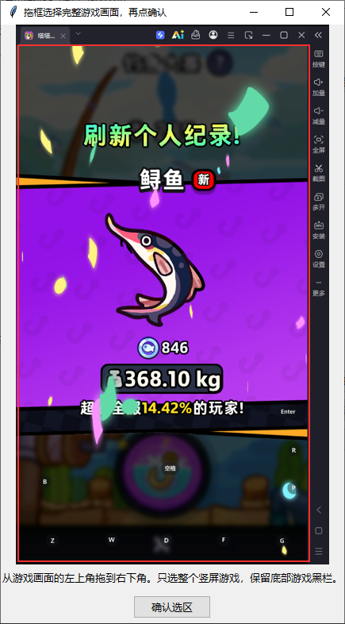

# 시뮬레이터 모드 원본 사용 설명서

[English](EMULATOR.md) · [繁體中文](EMULATOR.zh-TW.md) · [日本語](EMULATOR.ja.md) · 한국어

> 이 기술 문서에는 이전 버전과 측정 기록이 포함되어 있습니다. 현재 설치 방법과 지원 기능은 [기본 안내서](../README.ko.md)를 참고하세요.

이 매뉴얼에는 시뮬레이터 진입을 위한 작동 및 타이밍 지침이 포함되어 있습니다. 모바일 버전 설치 및 이용 방법은 [tt tool](../README.ko.md). 매뉴얼에 나오는 버전과 이식 가능한 패키지 이름은 에뮬레이터 버전에 속합니다.

Windows의 Raiden/MuMu 에뮬레이터용 Python 이미지 인식 피싱 도구입니다. 스크린샷 판정 단계를 거쳐 게임 메모리를 읽지 않고 훅, 풀훅, 옐로바 판정, 정산반환이 공백으로 완료됩니다.

[GitHub 프로젝트 ](https://github.com/Estrella-071/tt-tool) · [업데이트 기록 ](../CHANGELOG.ko.md)

> 본 프로젝트는 학습과 소통을 위해 무료로 제공됩니다. 잠금 해제를 위해 라이선스, 활성화 코드를 구매하거나 비용을 청구할 필요가 없습니다. 위의 프로젝트 주소에서 소스코드를 받아주세요.

현재 버전 **1.6.1**. "연속 낚시"가 기본적으로 선택되어 있으며 6개의 참조 프레임마다(약 10회/초) 스크린샷이 촬영되고 노란색 막대 버튼은 연속 앞뒤 모션 타이밍으로 예약되어 있습니다. 스크린샷은 위치만 수정합니다. 미리보기는 기본적으로 숨겨져 있으며 추적, 스크린샷, 실행 로그 또는 진단 ZIP은 자동으로 저장되지 않습니다. 소스 코드 배포 패키지에는 완전한 소스 코드와 필요한 리소스가 포함되어 있습니다. Windows 설치가 필요 없는 패키지에는 외부 "Start Phishing Assistant.bat"를 사용하여 시작할 수 있는 실행 환경도 함께 제공됩니다.
## 기능

- 훅킹 준비 상태, 훅 대기 상태, 훅 당김 상태, 옐로바 판정 및 결과 표시 등을 자동으로 식별합니다.
- 노란색 막대 건너뛰기 또는 연속적인 노란색 막대 판단 라운드를 지원합니다.
- "팀 기록 새로 고침" 화면을 포함하여 일반적인 "행복한 수락"과 파란색, 보라색, 황금색 및 빨간색-주황색 그라데이션 기록 정산 페이지를 지원합니다.
- 결과 페이지는 첫 번째 키 누르기가 허용되지 않을 때 멈추는 것을 방지하기 위해 기다린 후 공간을 계속 재시도합니다.
- 논스톱 낚시, 시간/시간 제한, 스크린샷 간격 및 단축키를 구성할 수 있습니다.
- 디포커스 일시정지, 수동 긴급 일시정지, 스크린샷, 수동 녹화 및 오프라인 재생.

## 다운로드 및 실행

새 디렉터리에 압축을 풀고 원래 Anaconda 환경 또는 PyCharm에서 `main.py`를 실행합니다. 종속성이 이미 설치된 경우 환경을 다시 설치할 필요가 없습니다. 업그레이드하면 이전 디렉토리에서 `config.json` 및 `speed_profile.json`를 복사할 수 있습니다. 첫 번째 업그레이드에서는 "낚시 계속"을 확인하고 이전 기본 스크린샷 간격을 30에서 6으로 변경합니다. 기타 사용자 정의된 스크린샷 간격, 단축키, 대기 시간 및 속도 매개변수는 유지됩니다. 업그레이드 후 다시 수정한 설정은 정상적으로 저장됩니다.
소스 코드 방법에는 Windows, Python 3.10 이상 및 다음 종속성이 필요합니다.

```bash
python -m pip install -r requirements.txt
python main.py
```

PyCharm을 사용하는 경우 `main.py`가 포함된 프로젝트 폴더를 열고 해당 인터프리터를 선택합니다. 종속성이 이미 설치되어 있으면 Anaconda를 다시 설치할 필요가 없습니다. 소스 코드를 실행하려면 Tkinter가 필요합니다. 인터프리터에 포함되어 있지 않으면 해당 Conda 환경에 `tk`를 설치할 수 있습니다. 게임의 전체 수직 화면 종횡비는 약 336:598입니다.

LDPlayer 또는 MuMu 시뮬레이터와 게임은 직접 준비해야 합니다. 종속성이 포함된 배포 패키지를 직접 만들어야 하는 경우 [Windows Portable Edition Build ](WINDOWS.ko.md); 현재 소스 코드 패키지에는 Python 또는 타사 종속성 파일이 포함되어 있지 않습니다.

## 공간 매핑 설정

시뮬레이터에서 원형 낚시 버튼의 아래쪽 절반이 "Happy Take" 버튼과 겹치는 위치에 공간을 매핑합니다. 이 위치는 두 인터페이스의 버튼 내에 있어야 합니다.

각각 수동으로 확인하십시오. 공간을 걸고, 당기고, 노란색 막대 작업을 완료하고, "행복한 수락" 및 기록 정산 페이지를 닫을 수 있습니다. 프로그램은 항상 공백만 보내고 Enter 키를 눌러도 자동으로 변경되지 않습니다. 채팅 상자나 기타 버튼에 공간 매핑을 넣지 마세요.

## 전체 게임 화면 프레임 지정

1. 프로그램을 실행하고 1단계에서 "Thunder Simulator" 또는 "MuMu Simulator"를 선택한 후 해당 게임 창을 선택합니다.
2. "2. 전체 게임 화면 구성"을 클릭하면 3초 이내에 시뮬레이터로 다시 전환됩니다.
3. 게임의 왼쪽 상단에서 스크린샷의 오른쪽 하단으로 드래그하여 선택을 확인하세요.

**전체 수직 화면 게임 영역만 선택하세요. 게임 외부의 시뮬레이터 제목 표시줄, 오른쪽 도구 모음 및 검은색 테두리를 선택하지 마십시오. 게임 내에서 하단의 검은색 막대를 유지합니다. ** 물고기, 노란색 막대 또는 낚시 버튼만 프레임에 넣지 말고 상단, 왼쪽 및 오른쪽 가장자리 또는 하단 인터페이스를 생략하지 마십시오.

아래 그림의 빨간색 상자가 올바른 예입니다. 예는 결과 페이지에 있으며, 다른 낚시 단계에서는 동일한 전체 게임 선택을 사용합니다. 이 이미지는 프로그램의 "뷰 프레임 선택 예"를 통해서도 열 수 있습니다.

를 제외합니다.

창 목록은 선택한 에뮬레이터의 제목으로 필터링되며 다중 열기 관리자는 기본 대상이 아닙니다. 인스턴스가 사용자 정의 이름을 사용하고 목록에 나타나지 않는 경우 "다른 창 표시"를 선택하고 실제로 게임을 실행하는 창을 수동으로 선택할 수 있습니다. 시뮬레이터를 전환한 후 다시 확인하고 선택합니다. 다른 시뮬레이터의 선택 사항은 혼합되지 않습니다. Thunderbolt와 MuMu는 모두 보이는 창 스크린샷과 전경 공간 매핑을 사용하며 ADB나 게임 파일 수정이 필요하지 않습니다.

시뮬레이터 창 크기, 해상도 또는 디스플레이 비율을 조정한 후에는 모니터링을 중지하고 다시 선택해야 합니다. 프로그램은 창을 이동할 때만 해당 위치를 따릅니다. 게임은 눈에 띄고 방해받지 않는 상태로 유지되어야 합니다.

## 시작 및 일시중지

1. "낚시 옵션"에서는 낚시 중지 여부, 스크린샷 간격, 최대 횟수/분 등을 설정합니다.
2. "3. 설정 적용 및 모니터링 켜기"를 클릭하세요. 현재는 스크린샷 인식만 수행되며, 자동 피싱은 아직 지원되지 않습니다.
3. 시뮬레이터로 다시 전환하려면 시작 바로 가기 키를 누르십시오. 기본값은 **F8**입니다. 또는 "4. 3초 안에 낚시 시작"을 클릭하면 즉시 시뮬레이터로 다시 전환됩니다.
4. 상단에 "자동으로 스페이스 누르기 · 실행 중"이 나타난 후 작업을 시작합니다.

"관찰만"은 기본적으로 선택되어 있지 않습니다. 체크하면 인식 결과만 조회되며 공백은 전송되지 않습니다. 소프트웨어는 열 때마다 일시 중지된 상태로 유지되며 자체적으로 작동하지 않습니다.

도우미, 브라우저 또는 기타 창을 클릭하면 에뮬레이터가 포커스를 잃고 일시 중지됩니다. 시뮬레이터로 돌아온 후 다시 시작해야 합니다. 프로젝트 링크를 클릭하거나 프레임에 포함된 예제를 열면 작업이 일시 중지됩니다. 프로그램을 닫으면 백그라운드 루프가 중지되고 프로그램이 누른 공간이 해제됩니다.

| 기능 | 기본 단축키 |
|---|---|
| 시작/일시 중지 | F8 |
| 비상정지, 3초 시동취소 | F9 |
| 게임 스크린샷 저장 | F10 |

"단축키 및 지연" 페이지에서 F1~F12까지 다른 키로 변경할 수 있습니다. 세 개의 키는 반복될 수 없습니다. 수정 전 모니터링을 중지하고, 수정 후 다시 3단계에서 적용을 클릭하세요. 인터페이스는 시뮬레이터 또는 다른 소프트웨어의 단축키와의 충돌을 피하기 위해 현재 활성 키를 표시합니다.

## 논스톱 낚시 및 스크린샷 빈도

"낚시를 멈추지 마세요"가 기본적으로 선택되어 있으며, 시간 및 분의 상한은 적용되지 않습니다. 결제 완료 후 다음 항목으로 진행하세요. 제한사항을 복원하려면 선택을 취소하세요. 낚시를 다시 시작할 때마다 횟수와 지속시간이 다시 계산됩니다.

연속 모드는 여전히 수동 일시 중지, 초점 이탈 및 무응답 보호 기능을 유지하며, 미끼 구매 및 보충과 같은 알 수 없는 팝업 창이나 버튼을 맹목적으로 클릭하지 않습니다.

"단축키 및 지연" 페이지에서 "확인되지 않은 화면 대기"를 설정할 수 있습니다. 기본값은 60초입니다. "노란색 막대 단계 대기"의 기본값은 120초입니다. 두 항목의 범위는 0~3600초입니다. 해당 자동 시간 초과를 끄려면 0을 입력합니다. 이미지가 확인되지 않는 기간에는 관찰만 수행되며 공백은 전송되지 않습니다. F9 및 초점이 맞지 않는 일시 중지는 여전히 유효합니다. 이전 버전의 미확인 대기 시간이 원래 기본값인 12초로 유지된다면, 업그레이드 시 60초로 변경되며, 기타 커스텀 값은 그대로 유지됩니다.

"모든 프레임 스크린샷"은 1부터 60까지의 정수를 허용하고 **초당 기준 프레임 60개**에 따라 시간을 변환하며 게임의 내부 프레임 번호를 읽지 않습니다.

| 입력값 | 스크린샷 간격 | 초당 스크린샷 대상 |
|---:|---:|---:|
| 6(기본값) | 100밀리초 | 10번 |
| 12 | 200ms | 5회 |
| 30 | 500밀리초 | 2번 |
| 60 | 1000밀리초 | 1회 |

인식 응답 속도를 추구하려면 더 작게 조정할 수 있습니다. 컴퓨터가 정지되면 더 크게 조정하여 스크린샷과 인식 오버헤드를 줄일 수 있습니다. 값을 늘리면 샘플링 속도도 느려지고 짧은 후크 프롬프트를 놓치기 쉬워집니다. 값이 작을수록 전반적인 낚시 효율성이 높아지는 것은 아닙니다. 노란색 막대 클릭은 별도의 마침표를 사용하며 다음 스크린샷을 기다릴 필요가 없습니다. 대상에 접근하거나 보정을 수행할 때 추가 스크린샷은 암호화되지 않습니다. 인터페이스에는 실제 스크린샷 수가 표시됩니다. 미리보기는 기본적으로 숨겨져 있습니다. 숨기면 주석 도면과 인터페이스 이미지 변환을 건너뜁니다. 키 마감일이 가까워지면 키가 먼저 처리된 후 스크린샷이 촬영됩니다. 실제 스크린샷 빈도는 설정된 값보다 약간 낮을 수 있습니다.

## 합의 및 노란색 막대 판결

결과 페이지에서 지속적으로 확인 후 기본 대기 시간은 3초이며 이후 스페이스바를 누릅니다. 화면이 여전히 정산 페이지 또는 "행복한 수락"을 기록하고 있는 경우 ±40밀리초의 임의 간격으로 약 1초마다 재시도됩니다. 재시도 횟수에는 상한이 없습니다. 각 작업은 새로운 스크린샷을 기반으로 합니다. 결제 페이지를 떠난 후 닫기 작업을 중지하고 후크를 클릭하기 전에 초기 인터페이스를 확인하세요. 시스템 지연 및 스크린샷 처리로 인해 실제 간격이 연장될 수 있습니다.

"행복한 수락"은 제목, 녹색 버튼 영역, 지정된 위치의 흰색 텍스트 및 어두운 배경의 조합을 통해 인식됩니다. 텍스트는 작은 범위의 크기 조정을 허용하며 녹색 음영에 의존하지 않고도 완전히 일관됩니다. 기록 페이지는 무게 아이콘, 파란색/보라색/황금색/빨간색-주황색 그라데이션 패널 및 어두운 배경의 조합으로 식별되며 물고기 이름이나 "개인/팀 기록" 제목에 의존하지 않습니다. 알 수 없는 인터페이스가 여전히 키를 누르지 않습니다. 기록 페이지와 다음 페이지 간 전환은 단일 정산 프로세스를 공유합니다.

노란색 막대 단계에서는 연속 모션 단계가 고정된 비례 속도로 유지됩니다. 처음에는 오른쪽으로, 시간 역방향으로 끝점으로, 이후 스크린샷을 통해 위치를 수정합니다. 여러 라운드의 판정은 각 라운드를 시작점으로 재설정하지 않고 이전 라운드의 위치에서 계속됩니다.

물고기 찌의 중앙이 이미 노란색 영역에 있을 때 즉시 버튼을 누르십시오. 아직 진입하지 않은 경우, 종점까지의 경로와 되돌아오는 경로를 포함하여 노란색 막대 중앙을 통과하는 다음 클릭 시간을 예약합니다. 목표 범위가 좁아도 고정된 안전 마진으로 인해 작업이 중단되지 않습니다. 동일한 패스에 대해서는 한 번만 누르십시오. 노란색 막대가 다음 라운드로 변경된 후 버튼을 다시 누를 수 있습니다. 동일한 노란색 막대가 변경되지 않으면 다음 패스에서 다시 시도할 수 있습니다.

미리보기의 녹색 상자는 노란색 타겟을 나타내고, 빨간색 선은 물고기 부유물을 나타내며, 보라색 선은 예측 유효 위치를 나타냅니다. 타이밍 원리와 적용 가능한 경계는 [알고리즘 설명 ](ALGORITHM.ko.md).

## 비례 속도 및 교정

"속도 및 교정" 페이지에는 기본적으로 기준 속도 **초당 막대 너비의 60.6%**가 표시됩니다. 눈금 단위는 판단 막대의 보이는 외부 프레임의 전체 너비입니다. 플로트 센터의 실제 스트로크는 왼쪽 및 오른쪽 엔드 캡과 장식을 공제합니다. 계산은 원래 장치의 픽셀 크기에 의존하지 않습니다.

보정 선택을 취소할 때 저장된 기계 속도를 사용하십시오. 기계의 매개변수가 없을 때 참조 값을 사용하십시오. "This Calibration Speed"를 체크한 후 일반 스크린샷과 동일한 방향 변위 간격을 사용합니다. 샘플링 간격이 0.25초 미만인 경우 동일한 방향 변위 간격이 먼저 누적된 다음 제로 변위, 교차 끝점, 입력 모션 효과 및 명백한 이상값이 제거됩니다. 양방향 샘플이 안정되면 결과가 저장되고 교정이 완료됩니다. 부족할 경우 원래 값이 유지되며 반복적으로 덮어쓰지 않습니다. 보정을 해도 스크린샷 수가 늘어나지 않으며 원래의 궤적이 기록되지도 않습니다.

결과는 로컬 시스템 `speed_profile.json`에 저장되며 업그레이드 중에 새 디렉터리에 복사될 수 있습니다. 공개적으로 업로드하지 마세요. 초기값을 복원해야 할 경우 "Restore Reference Speed(기준 속도 복원)"를 클릭하십시오. 스크린샷은 여전히 ​​336×598로 먼저 표준화되어 있습니다. 종횡비를 변경하고 컨트롤을 다시 정렬할 때 비례 속도는 인식 적응을 대체할 수 없습니다.

"게임 응답 대기 시간 기준"의 기본값은 40밀리초이며 장치에 따라 조정될 수 있습니다. 자동 보상은 측정 가능한 로컬 입력 실행 시간만 학습할 뿐 게임 내 전체 응답 지연을 자동으로 알 수는 없습니다. 저주파 예측은 두 프레임 사이의 속도가 대략 균일하다고 가정하고 당분간 정지 프레임 감지를 통해 계획이 취소되지 않습니다. 긴 게임 일시 중지, 속도 변경 또는 시스템 예약 지연으로 인해 여전히 오류가 발생할 수 있습니다. 후크 준비 인터페이스에서 시작하는 것이 좋습니다.

## 설정 및 업그레이드

3단계를 클릭하면 설정이 저장됩니다. 휴대용 버전은 `data/config.json`에 저장되고 소스 코드 버전은 프로젝트 루트 디렉터리의 `config.json`에 저장됩니다. 처음에는 수동으로 만들 필요가 없습니다. `config.example.json`는 기본 구성을 표시하는 데만 사용되며 개인 선택 사항은 포함하지 않습니다.

| 공통 구성 | 기본값 | 의미 |
|---|---:|---|
| `emulator_type` | LD플레이어 | Thunder는 ldplayer, MuMu는 mumu |
| `continuous_fishing` | 사실 | 최대 횟수 및 분을 무시하려면 선택 |
| `capture_every_n_frames` | 6 | N 참조 프레임마다 스크린샷 |
| `input_latency_ms` | 40 | 게임 응답 대기 시간 벤치마크 및 제한된 기본 실행 보상 |
| `timing_mode` | 단계 | 연속 왕복 타이밍 및 저주파 위치 보정 |
| `unknown_timeout_s` | 60 | 확인되지 않은 화면의 최대 대기 시간(초)은 0으로 제한되지 않습니다 |
| `timing_timeout_s` | 120 | 노란색 막대 단계에서 가장 긴 대기 시간(초)은 0으로 제한되지 않습니다 |
| `speed_fraction_per_s` | 0.606 | 로컬 교정 파일이 없을 때 사용되는 비례 속도입니다. 교정 파일이 우선순위를 갖습니다 |
| `calibrate_speed` | 거짓 | 현재 모니터링은 교정을 요청합니다. 프로그램을 다시 시작해도 자동으로 확인되지 않습니다 |
| `adaptive_latency` | 사실 | 측정 가능한 로컬 실행 시간을 학습한다고 해서 게임 지연 시간이 자동으로 측정되는 것은 아닙니다 |
| `show_preview` | 거짓 | 인식 미리보기 표시 여부 |
| `key_hold_ms` | 35 | 단일 공백을 누르는 데 걸리는 시간 |
| `result_wait_s` | 3 | 첫 번째 결제를 위한 대기 시간 |
| `result_retry_s` | 1 | 정산 재시도 기본 간격 |
| `result_retry_jitter_ms` | 40 | 정산 재시도 간격 부동 밀리초 |
| `max_casts` | 20 | 멈추지 않고 낚시할 때 최대 후크 수를 확인하지 않음 |
| `max_session_minutes` | 15 | 멈추지 않고 낚시할 때의 상한 시간(분)이 확인되지 않습니다 |

휴대용 버전이 새 디렉토리로 업데이트되면 이전 버전 `data/`를 복사하여 설정 및 작동 데이터를 유지하십시오. 소스 버전에서 마이그레이션할 때 이전 `config.json`를 새 패키지의 `data/`에 넣으세요. 소스 코드 버전이 업데이트되면 원본 머신 `config.json`를 복사할 수 있습니다. 구성 버전 7이 처음으로 이전 설정을 읽을 때 "논스톱 낚시"가 활성화되고 이전 기본 간격인 30이 6으로 변경되며 기타 사용자 정의 스크린샷 간격은 유지됩니다. 이후 논스톱낚시를 취소하거나 30으로 재설정하시면 정상적으로 저장됩니다. 이전 단계 전략, 지름길, 지연 및 사용자 정의 대기 시간은 그대로 유지됩니다. 시뮬레이터 소유권을 확인하는 이전 선택 사항을 재사용할 수 있습니다. 창 크기가 변경된 후 선택 항목의 프레임을 다시 지정합니다. GitHub에 게시할 때 자신의 `config.json`를 업로드하지 마세요.

## 로컬 파일 및 문제 해결

일반 낚시는 실행 로그, 트레이스, 스크린샷 또는 진단 ZIP을 자동으로 저장하지 않으며 일시 정지하며 F9는 데이터를 패키징하지 않습니다. 설정 및 명확하게 완료된 속도 교정은 로컬에 저장됩니다. 게임 스크린샷을 저장하려면 F10을 누르세요. "녹화" 페이지에서 수동 녹화를 선택하면 자동 키 입력이 일시 중지되고 15초짜리 비디오와 해당 타임스탬프가 저장됩니다.

| 현상 | 검사방법 |
|---|---|
| 3단계 이후 아무 조치도 취하지 않음 | 4단계 또는 시작 단축키가 필요합니다. 탑이 작동하는지, 관찰만 체크되는지 확인 |
| 종료하지 않고 행복하게 수락 | 두 버튼이 겹치는 부분에 공간 매핑이 들어가고 화면이 결과페이지로 인식되는지 확인 |
| 알 수 없는 화면이 항상 표시됩니다 | 전체 프레임 선택, 게임 외부의 검은색 테두리, 폐색 및 팝업 창 확인 |
| 작동 중 일시 중지됨 | 가장 큰 이유를 확인하세요. 초점을 잃은 후 시뮬레이터를 다시 시작해야 합니다 |
| 키 입력이 적용되지 않습니다 | 공간 매핑, 채팅 포커스, 보조자 및 에뮬레이터의 권한 수준을 수동으로 확인 |
| 계속해서 너무 이르거나 너무 늦은지 판단 | 비례 속도 및 지연 벤치마크를 확인하세요. 속도는 명시적으로 보정될 수 있으며, 시작과 정지 시마다 보정할 필요가 없습니다 |

오프라인 확인은 시스템 입력을 보내지 않습니다.

```bash
python selfcheck.py
python replay.py
```

`replay.py`는 기본적으로 문서의 프레임 선택 예시를 확인하고, 자신만의 이미지나 영상을 지정하는 `--input`, 게임 범위를 지정하는 `--crop X Y W H`도 지원합니다. 제안된 동작만 출력하고 실제 게임 실행이나 히트를 보여주지 않습니다.

자료를 공개적으로 공유하기 전에 닉네임, 채팅 콘텐츠, 계정 정보, 로컬 경로를 제거하세요. 이 프로그램에는 자동 업로드 기능이 없습니다. 자세한 지침은 [로컬 데이터 및 공개 릴리스 ](PRIVACY.ko.md)를 참조하세요.

## 업로드 및 기여

이 릴리스 패키지의 압축을 푼 후 `README.md`, `main.py`, `fisher/`, `assets/` 등은 프로젝트 폴더의 추가 레이어를 추가하지 않고 웨어하우스의 루트 디렉터리에 배치되어야 합니다.

로컬에서 실행하거나 수정한 후 다음 항목을 사용하여 공개적으로 릴리스 가능한 소스 코드 패키지를 생성합니다.

```bash
python selfcheck.py
python build_release.py
```

`dist/tt-tool-source-版本号.zip`의 압축이 풀린 콘텐츠만 업로드하세요. 이 항목은 로컬 구성, 로그, 스크린샷, 비디오, 캐시 및 추가 개인 파일을 제외한 일반 파일 목록을 사용합니다. `.gitignore`는 Git 워크플로에도 사용됩니다. 전체 실행 디렉터리나 진단 패키지를 확인하지 않고 직접 업로드하지 마세요.

실행 환경이 포함된 Windows 배포 패키지를 만들려면 `python build_windows.py`를 실행하거나 웨어하우스에서 Windows 휴대용 워크플로를 사용하세요. 구체적인 단계는 [휴대용 버전 빌드 ](WINDOWS.ko.md). 이식 가능한 ZIP은 GitHub 릴리스 첨부 파일에 배치되고 소스 코드 파일은 전체 런타임 세트가 소스 코드 디렉터리에 업로드되는 것을 방지하기 위해 웨어하우스에 배치됩니다.

GitHub Issues를 통해 재현 가능한 문제를 제출하실 수 있습니다. 개발 구조 및 검증 방법은 [개발 지침 ](DEVELOPMENT.ko.md).

## 라이선스 및 사용 경계

소스 코드는 [GPL-3.0-only](../LICENSE). 연구, 수정 및 재배포는 허용됩니다. 수정된 버전을 배포할 경우 라이선스에 따라 관련 고지 사항을 유지하고 해당 소스 코드를 제공해야 합니다. 타사 게임 인터페이스 및 템플릿에 대한 권리 범위는 [NOTICE.md](../NOTICE.ko.md).

저자는 이 프로젝트를 무료로 제공하지만 GPL 자체는 유료 재배포를 허용하며 "판매 금지" 라이센스가 아닙니다. 오픈 소스 코드와 작성자 입구를 찾아보시고 소위 활성화 코드, 공식 승인 또는 잠금 해제 기능에 대한 비용을 지불하지 마십시오. 관련 라이센스 지침은 [GNU GPL FAQ ](https://www.gnu.org/licenses/gpl-faq.html#DoesTheGPLAllowMoney).

이 도구는 스크린샷과 입력을 로컬에서만 처리하므로 게임에서 감지되지 않는다는 의미는 아닙니다. 사용하기 전에 게임과 플랫폼에서 이 작업 방법을 허용하는지 확인하십시오. 특정 장치, 모든 어종 또는 후속 게임 버전의 성공률은 보장되지 않습니다.
