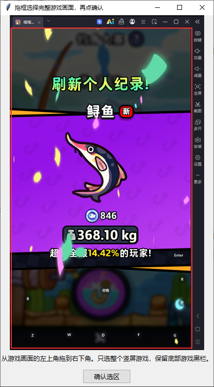

# Simulator Mode Original Operation Manual

English · [繁體中文](EMULATOR.zh-TW.md) · [日本語](EMULATOR.ja.md) · [한국어](EMULATOR.ko.md)

> This technical record includes historical versions and measurements. For current setup and supported workflows, see [the main guide](../README.md).

This manual preserves the operation and timing instructions for the simulator entry. For the installation and use of the mobile version, please see [tt tool](../README.md). Versions and portable package names in the manual belong to the emulator version.

Python image recognition phishing tool for the Raiden/MuMu emulator on Windows. Through the screenshot judgment stage, the hook, pull hook, yellow bar judgment and settlement return are completed with spaces, without reading the game memory.

[GitHub project ](https://github.com/Estrella-071/tt-tool) · [Update record ](../CHANGELOG.md)

> This project is provided free of charge for learning and communication. No need to purchase licenses, activation codes or charge to unlock; please get the source code from the project address above.

Current version **1.6.1**. "Continuous fishing" is checked by default, and a screenshot is taken every 6 reference frames (about 10 times/second), and the yellow bar button is reserved with continuous back-and-forth motion timing; the screenshot only corrects the position. The preview is hidden by default and traces, screenshots, running logs or diagnostic ZIPs are not automatically saved. The source code distribution package contains complete source code and necessary resources; the Windows installation-free package also comes with a running environment, which can be started using the outer "Start Phishing Assistant.bat".
## Function

- Automatically identify preparation for hooking, waiting for hooking, hook pulling, yellow bar judgment and result display.
- Supports skipping yellow bars or consecutive rounds of yellow bar judgments.
- Supports ordinary "happy acceptance" and blue, purple, golden and red-orange gradient record settlement pages, including the "refresh team record" screen.
- The result page continues to retry the space after waiting to avoid being stuck when the first key press is not accepted.
- Non-stop fishing, times/duration limit, screenshot interval and shortcut keys are configurable.
- Defocus pause, manual emergency pause, screenshot, manual recording and offline playback.

## Download and launch

Unzip it to a new directory and run `main.py` in the original Anaconda environment or PyCharm. There is no need to reinstall the environment when dependencies are already installed. Upgrading can copy `config.json` and `speed_profile.json` from the old directory; the first upgrade will check "Keep fishing" and change the old default screenshot interval of 30 to 6; other customized screenshot intervals, shortcut keys, waiting time and speed parameters will be retained. Settings modified again after the upgrade will be saved normally.
The source code method requires Windows, Python 3.10 or above, and the following dependencies:

```bash
python -m pip install -r requirements.txt
python main.py
```

When using PyCharm, open the project folder containing `main.py` and select the corresponding interpreter. There is no need to reinstall Anaconda when its dependencies are already installed. Tkinter is required to run the source code; if the interpreter does not include it, `tk` can be installed in the corresponding Conda environment. The complete vertical screen aspect ratio of the game is approximately 336:598.

LDPlayer or MuMu simulators and games need to be prepared by yourself. When you need to make your own distribution package containing dependencies, you can refer to [Windows Portable Edition Build ](WINDOWS.md); the current source code package does not contain Python or third-party dependency files.

## Set space mapping

In the simulator, map the space to where the lower half of the circular fishing button overlaps the "Happy Take" button. This position should fall within the button in both interfaces.

Manually confirm respectively: the space can be hooked, pulled, completed the yellow bar operation, and closed the "Happy Acceptance" and record settlement page. The program always only sends spaces and will not automatically change to press Enter. Don't put space mappings on chat boxes or other buttons.

## Frame the complete game screen

1. Run the program, select "Thunder Simulator" or "MuMu Simulator" in step 1, and then select the corresponding game window.
2. Click "2. Frame the complete game screen" to switch back to the simulator within 3 seconds.
3. Drag from the upper left corner of the game to the lower right corner in the screenshot to confirm the selection.

**Only select the complete vertical screen game area. Do not select the simulator title bar, right toolbar, and black borders outside the game; retain the bottom black bar inside the game. ** Don't just frame the fish, yellow bars, or fishing buttons, and don't leave out the top, left and right edges, or bottom interface.

The red box in the picture below is a correct example. The example is on the results page, the other fishing stages use the same full game selection. This image can also be opened by "View Frame Selection Example" in the program.



The window list is filtered by the title of the selected emulator, multi-open managers will not be the default target. When the instance uses a custom name and does not appear in the list, you can check "Show other windows" and manually select the window that actually runs the game. Recheck and select after switching simulators; selections from different simulators will not be mixed. Both Thunderbolt and MuMu use visible window screenshots and foreground space mapping, and do not require ADB or modification of game files.

After adjusting the simulator window size, resolution or display ratio, you should stop monitoring and re-select. The program will only follow its position when moving the window. The game must remain visible and unobstructed.

## Start and pause

1. In "Fishing Options", set whether to stop fishing, the interval between screenshots, and the upper limit of times/minutes.
2. Click "3. Apply settings and turn on monitoring". At this time, only screenshot recognition is performed, and automatic phishing is not yet available.
3. To switch back to the simulator, press the start shortcut key, the default is **F8**; or click "4. Start fishing in 3 seconds" to switch back to the simulator immediately.
4. Start the operation after "Automatically press space · Running" appears at the top.

"Observe only" is not checked by default; if checked, only the recognition results will be viewed and no spaces will be sent. The software remains paused every time it is opened and will not operate on its own.

Clicking on the assistant, browser, or other window will cause the emulator to lose focus and pause. A restart is required after returning to the simulator. Clicking on a project link or opening a framed example will also pause the operation. Closing the program stops the background loop and releases the space pressed by the program.

| Function | Default shortcut keys |
|---|---|
| Start/Pause | F8 |
| Emergency pause, cancel 3-second start | F9 |
| Save game screenshot | F10 |

On the "Shortcut Keys and Delay" page, you can change it to other keys from F1 to F12. The three keys cannot be repeated. Stop monitoring before modification, and click Apply again in step 3 after modification. The interface displays the currently active keys to avoid conflict with the hotkeys of the simulator or other software.

## Non-stop fishing and screenshot frequency

"Never stop fishing" is checked by default, and neither the upper limit of times nor minutes takes effect. After completing the settlement, continue to the next item. Uncheck to restore restrictions. Each time fishing is restarted, the number and duration will be recalculated.

The continuous mode still retains manual pause, out-of-focus and unresponsive protection, and will not blindly click on unknown pop-up windows or buttons such as purchase and replenishing bait.

On the "Shortcut Keys and Delay" page, you can set the "Unconfirmed Screen Wait", which defaults to 60 seconds; the "Yellow Bar Phase Wait" defaults to 120 seconds. The range of both items is 0~3600 seconds. Fill in 0 to turn off the corresponding automatic timeout. During the period when the image is not confirmed, only observation is performed and no spaces are sent; F9 and out-of-focus pause are still valid. If the unconfirmed wait of the old version remains the original default of 12 seconds, it will be changed to 60 seconds when upgrading, and other custom values ​​will be retained.

"Screenshot every frame" accepts integers from 1 to 60, and converts time according to **60 baseline frames per second**, without reading the game's internal frame number.

| Input value | Screenshot interval | Screenshot target per second |
|---:|---:|---:|
| 6 (default) | 100 milliseconds | 10 times |
| 12 | 200ms | 5 times |
| 30 | 500 milliseconds | 2 times |
| 60 | 1000 milliseconds | 1 time |

To pursue recognition response speed, you can adjust it smaller; when your computer freezes, you can adjust it larger to reduce screenshots and recognition overhead. Increasing the value will also slow down sampling and make it easier to miss short hook prompts. Smaller values ​​do not guarantee higher overall fishing efficiency. The yellow bar click uses a separate period and does not need to wait for the next screenshot; no additional screenshots are encrypted when approaching the target or performing calibration. The interface displays the actual number of screenshots. The preview is hidden by default; annotation drawing and interface image conversion are skipped when hidden. When the key deadline is approaching, the keys will be processed first and then screenshots will be taken. The actual frequency of screenshots may be slightly lower than the set value.

## Settlement and Yellow Bar Judgment

After continuous confirmation on the result page, the default wait is 3 seconds, and then press space. If the screen is still recording the settlement page or "Happy Acceptance", it will be retried approximately every 1 second with a random interval of ±40 milliseconds. There is no upper limit for the number of retries. Each operation is based on a new screenshot; stop the closing action after leaving the checkout page, and confirm the initial interface before clicking the hook. System lag and screenshot processing may extend the actual interval.

"Happy Acceptance" is recognized through the combination of title, green button area, white text at the designated position and dark background; the text allows for small range scaling and is completely consistent without relying on green shading. Record pages are identified by a combination of weight icons, blue/purple/golden/red-orange gradient panels, and dark backgrounds, and do not rely on fish names or "Personal/Team Record" titles. Unknown interface still does not press keys. Switching between the record page and the next page shares a single settlement process.

In the yellow bar stage, the continuous motion phase is maintained at a fixed proportional speed: initially to the right, to the end point in time reverse direction, and subsequent screenshots to correct the position. Multiple rounds of judgment continue from the position of the previous round without resetting each round to the starting point.

Press the button immediately when the center of the fish float is already in the yellow area; when it has not yet entered, reserve the next click time passing through the middle of the yellow bar, including the route to the endpoint and then back. Even if the target is narrow, the operation will not be stopped due to the fixed safety margin. You can only press once for the same pass; you can press the button again after the yellow bar changes to the next round; if the same yellow bar does not change, you are allowed to try again at the next pass.

The green box in the preview indicates the yellow target, the red line indicates the fish float, and the purple line indicates the prediction effective position. For timing principles and applicable boundaries, see [Algorithm Description ](ALGORITHM.md).

## Proportional speed and calibration

The "Speed ​​and Calibration" page displays the reference speed **60.6% of the bar width per second** by default. The scale unit is the full width of the visible outer frame of the judgment bar; the actual stroke of the float center will deduct the left and right end caps and decorations. Calculation does not depend on the pixel size of the original device.

When unchecking the calibration, use the saved speed of the machine; use the reference value when there are no parameters of the machine. After checking "This Calibration Speed", use the same direction displacement interval in the normal screenshot. When the sampling interval is less than 0.25 seconds, the same direction displacement interval is first accumulated, and then zero displacement, cross-end points, input motion effects and obvious outliers are eliminated. After the bidirectional sample is stable, the results are saved and the calibration is completed; when insufficient, the original value is retained and is not overwritten repeatedly. Calibration will not increase the number of screenshots, nor will the original trajectory be written.

The results are saved in the local machine `speed_profile.json` and can be copied to a new directory during upgrade; do not upload them publicly. Click "Restore Reference Speed" when you need to restore the initial value. The screenshot is still normalized to 336×598 first; when changing the aspect ratio and causing the controls to be rearranged, the proportional speed cannot replace the recognition adaptation.

The "Game Response Latency Baseline" defaults to 40 milliseconds and can be adjusted according to the device. Automatic compensation only learns the measurable local input execution time, and cannot automatically know the complete response delay within the game. Low-frequency prediction assumes that the speed between two frames is approximately uniform, and the plan is not canceled through freeze frame detection for the time being; long game pauses, speed changes, or system scheduling delays may still cause errors. It is recommended to start from the hook preparation interface.

## Setup and upgrade

The settings are saved when clicking step 3; the portable version is saved in `data/config.json`, and the source code version is saved in `config.json` in the project root directory. There is no need to create it manually for the first time. `config.example.json` is only used to display the default configuration and does not include any personal selections.

| Common configuration | Default | Meaning |
|---|---:|---|
| `emulator_type` | ldplayer | Thunder is ldplayer, MuMu is mumu |
| `continuous_fishing` | true | Check to ignore the maximum number of times and minutes |
| `capture_every_n_frames` | 6 | Screenshot every N reference frames |
| `input_latency_ms` | 40 | Game response latency benchmark, plus bounded native execution compensation |
| `timing_mode` | phase | Continuous round-trip timing and low-frequency position correction |
| `unknown_timeout_s` | 60 | The maximum waiting seconds for unconfirmed screen, no limit to 0 |
| `timing_timeout_s` | 120 | The longest waiting seconds in the yellow bar stage, no limit to 0 |
| `speed_fraction_per_s` | 0.606 | The proportional speed used when there is no local calibration file; the calibration file takes priority |
| `calibrate_speed` | false | Current monitoring requests calibration; restarting the program will not automatically check |
| `adaptive_latency` | true | Learning measurable local execution time does not mean automatically measuring game latency |
| `show_preview` | false | Whether to display recognition preview |
| `key_hold_ms` | 35 | How long to hold down single space |
| `result_wait_s` | 3 | Seconds to wait for the first settlement |
| `result_retry_s` | 1 | Settlement retry base interval |
| `result_retry_jitter_ms` | 40 | Settlement retry interval floating milliseconds |
| `max_casts` | 20 | The maximum number of hooks when fishing without stopping is not checked |
| `max_session_minutes` | 15 | The upper limit of minutes when fishing without stopping is not checked |

When the portable version is updated to a new directory, copy the old version `data/` to retain the settings and operating data; when migrating from the source version, put the old `config.json` into the new package's `data/`. When the source code version is updated, the original machine `config.json` can be copied. When configuration version 7 reads the old settings for the first time, "non-stop fishing" is enabled, the old default interval of 30 is changed to 6, and other customized screenshot intervals are retained. Afterwards, canceling non-stop fishing or resetting it to 30 will save it normally. Old phase strategies, shortcuts, delays, and custom waiting times are retained; old selections that confirm simulator ownership can be reused. Reframe the selection after the window size changes. Do not upload your own `config.json` when publishing to GitHub.

## Local files and troubleshooting

Normal fishing does not automatically save running logs, traces, screenshots or diagnostic ZIP, and pause and F9 will not package data. Setup and clearly completed speed calibration are saved locally. Press F10 to save game screenshots; manual recording on the "Recording" page will pause automatic keystrokes and save the 15-second video and corresponding timestamp.

| Phenomenon | Inspection method |
|---|---|
| No action after step 3 | Step 4 or start shortcut key is required; check whether the top is running and whether only observation is checked |
| Accept it happily without exiting | Check whether the space mapping falls in the overlapping area of ​​the two buttons, and the screen is recognized as a result page |
| The unknown screen is always displayed | Check the complete frame selection, black borders outside the game, occlusion and pop-up windows |
| Paused during operation | See the top reason; the simulator needs to be restarted after losing focus |
| Keystrokes do not take effect | Manually check space mapping, chat focus, and permission levels of assistants and emulators |
| Determine if it continues to be too early or too late | Check the proportional speed and delay benchmark; the speed can be explicitly calibrated, no need to calibrate every start and stop |

Offline checking does not send system input:

```bash
python selfcheck.py
python replay.py
```

`replay.py` checks the frame selection example in the document by default, and also supports `--input` to specify your own images or videos, and `--crop X Y W H` to specify the game range. It only outputs proposed moves and does not demonstrate real game execution or hits.

Remove nicknames, chat content, account information, and local paths before sharing material publicly. The program does not have an automatic upload function; see [Local Data and Public Release ](PRIVACY.md) for more instructions.

## Upload and contribute

`README.md`, `main.py`, `fisher/`, `assets/`, etc. after decompression of this release package should be placed in the root directory of the warehouse without adding an additional layer of project folders.

After running or modifying it locally, use the following entry to generate a publicly releasable source code package:

```bash
python selfcheck.py
python build_release.py
```

Only upload the decompressed content of `dist/tt-tool-source-版本号.zip`. This entry uses a clear file list, excluding local configuration, logs, screenshots, videos, caches and additional personal files; `.gitignore` is also used for Git workflow. Do not directly upload the entire run directory or diagnostic package without checking it.

To create a Windows distribution package containing a running environment, please run `python build_windows.py`, or use the Windows portable workflow in the warehouse; for specific steps, see [Portable version build ](WINDOWS.md). The portable ZIP is placed in the GitHub Release attachment, and the source code files are placed in the warehouse to avoid uploading the entire runtime set into the source code directory.

You are welcome to submit reproducible issues through GitHub Issues. For the development structure and verification method, see [Development Instructions ](DEVELOPMENT.md).

## Licensing and usage boundaries

The source code adopts [GPL-3.0-only](../LICENSE). Studying, modifying and redistributing is allowed; when distributing modified versions, you need to retain relevant notices according to the license and provide corresponding source code. The scope of rights for third-party game interfaces and templates is found at [NOTICE.md](../NOTICE.md).

The author provides this project for free, but the GPL itself allows redistribution for a fee and is not a "no sale" license. Please look for the open source code and author entrance, and do not pay for the so-called activation code, official authorization or unlocking functions. Relevant license instructions can be found in [GNU GPL FAQ ](https://www.gnu.org/licenses/gpl-faq.html#DoesTheGPLAllowMoney).

The tool only processes screenshots and input locally, which does not mean it will not be detected by the game. Please confirm that the game and platform allow this operation method before use; the success rate of specific devices, all fish species, or subsequent game versions is not guaranteed.
