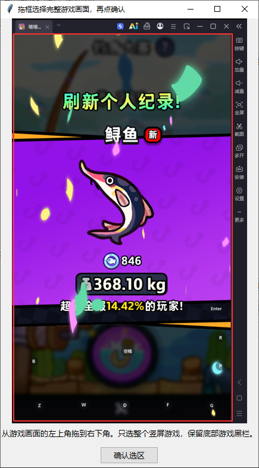

# 模擬器模式原始操作手冊

[English](EMULATOR.md) · 繁體中文 · [日本語](EMULATOR.ja.md) · [한국어](EMULATOR.ko.md)

> 此技術文件包含歷史版本與測量紀錄。目前的安裝方式和支援功能請見[主要指南](../README.zh-TW.md)。

這份手冊保留模擬器入口的操作與時序說明。手機版的安裝及使用請見 [tt tool](../README.zh-TW.md)。手冊中的版本與便攜包名稱屬於模擬器版本。

面向 Windows 上的雷電/MuMu模擬器的 Python 影像辨識釣魚工具。透過螢幕截圖判斷階段，以空格完成下鉤、拉鉤、黃條判定和結算返回，不讀取遊戲記憶體。

[GitHub 專案](https://github.com/Estrella-071/tt-tool) · [更新記錄](../CHANGELOG.zh-TW.md)

> 本項目免費提供，用於學習與交流。無需購買授權、啟動碼或收費解鎖；請從上面的項目地址取得原始碼。

目前版本 **1.6.1**。預設勾選“不停釣”，每6個基準幀截圖一次（約10次/秒），用連續往返運動計時預約黃條按鍵；截圖只校正位置。預覽預設隱藏，不自動儲存軌跡、截圖、運行日誌或診斷ZIP。原始碼發行包包含完整原始碼和必要資源；Windows免安裝包另帶運行環境，使用外層的「啟動釣魚助手.bat」啟動。
## 功能

- 自動辨識準備下鉤、等待上鉤、拉鉤、黃條判定和結果展示。
- 支援跳過黃條或連續多輪黃條判定。
- 支援普通「開心收下」及藍色、紫色、金黃色及紅橙漸層紀錄結算頁，包括「刷新團隊紀錄」畫面。
- 結果頁等待後持續重試空格，避免首次按鍵未被接受而停住。
- 不停釣、次數/時長限制、截圖間隔和快捷鍵可設定。
- 失焦暫停、手動緊急暫停、截圖、手動錄製和離線重播。

## 下載與啟動

解壓到新目錄，在原Anaconda環境或PyCharm中運行 `main.py`。已安裝依賴時無需重裝環境。升級可複製舊目錄的 `config.json` 和 `speed_profile.json`；首次升級會勾選“不停釣”，並將舊預設截圖間隔30改為6；其他自訂截圖間隔、快捷鍵、等待時間和速度參數保留。升級後再次修改的設定會正常儲存。
原始碼方式要求Windows、Python 3.10或以上，以及以下依賴：

```bash
python -m pip install -r requirements.txt
python main.py
```

使用PyCharm時，開啟包含 `main.py` 的專案資料夾並選擇對應解釋器。 Anaconda已安裝依賴時無需重新安裝。原始碼運作需要Tkinter；若解釋器不包含它，可在對應Conda環境安裝 `tk`。遊戲完整垂直畫面畫面比例約336∶598。

雷電或MuMu模擬器及遊戲需自行準備。需自行製作包含依賴的發行包時，可參考 [Windows便攜版建置](WINDOWS.zh-TW.md)；目前原始碼包不包含Python或第三方依賴檔。

## 設定空格映射

在模擬器中，將空格對應到**圓形釣魚按鈕下半部與「開心收下」按鈕重疊的位置**。這一位置應能在兩種介面中都落入按鈕內。

分別手動確認：空格可以下鉤、拉鉤、完成黃條操作，並關閉「開心收下」和紀錄結算頁。程式總是只發送空格，不會自動改按回車。不要把空格映射放在聊天框或其他按鈕上。

## 框選完整遊戲畫面

1. 執行程序，在步驟1選擇“雷電模擬器”或“MuMu模擬器”，然後再選擇對應遊戲視窗。
2. 點選“2. 框選完整遊戲畫面”，在3秒內切回該模擬器。
3. 在截圖裡從遊戲左上角拖到右下角，確認選區。

**只選完整的垂直畫面遊戲區域。模擬器標題列、右側工具列和遊戲外側的黑邊不要選；遊戲內部的底部黑色欄位要保留。 ** 不要只框魚、黃條或釣魚按鈕，也不要漏掉頂部、左右邊緣或底部介面。

下圖紅框是正確範例。範例處於結果頁，其他釣魚階段使用相同的完整遊戲選區。程式內的「檢視框選範例」也可開啟此圖。



視窗清單以所選模擬器的標題篩選，多開管理器不會作為預設目標。實例使用自訂名稱而沒有出現在清單時，可勾選“顯示其他視窗”，手動選擇實際執行遊戲的視窗。切換模擬器後重新核對並框選；不同模擬器的選取範圍不會混用。雷電與MuMu都使用可見視窗截圖和前臺空格映射，不需要ADB或修改遊戲檔案。

調整模擬器視窗大小、解析度或顯示比例後，應停止監控並重新框選。僅移動視窗時程式會跟隨其位置。遊戲必須保持可見且無遮蔽。

## 開始與暫停

1. 在「釣魚選項」中設定是否不停釣、截圖間隔以及次數／分鐘上限。
2. 點選「3. 應用設定並開啟監測」。此時只進行截圖識別，尚未自動釣魚。
3. 切回模擬器按開始快速鍵，預設 **F8**；或點擊“4. 3秒後啟動釣魚”，立即切回模擬器。
4. 頂部出現「自動按下空格 · 運行中」後開始操作。

預設不勾選「僅觀察」；勾選後只查看辨識結果，不發送空格。每次開啟軟體都保持暫停，不會自行操作。

點選助手、瀏覽器或其他視窗會使模擬器失焦並暫停。返回模擬器後需要重新啟動。點擊項目連結或開啟框選範例也會暫停操作。關閉程式會停止背景循環並釋放本程式按下的空格。

| 功能 | 預設快捷鍵 |
|---|---|
| 開始/暫停 | F8 |
| 緊急暫停、取消3秒啟動 | F9 |
| 儲存遊戲截圖 | F10 |

在「快捷鍵與延遲」頁可改為F1～F12中的其他鍵，三個鍵不能重複。修改前停止監測，修改後重新點選第3步驟應用。介面顯示目前生效鍵，避免與模擬器或其他軟體的熱鍵衝突。

## 不停釣與截圖頻率

預設勾選“不停釣”，次數和分鐘兩個上限都不生效，完成結算後繼續下一條。取消勾選後恢復限制。每次重新啟動釣魚會重新計算次數和長度。

持續模式仍保留手動暫停、失焦和無回應保護，不會盲目點擊未知彈跳窗或購買、補充魚餌等按鈕。

在“快捷鍵與延遲”頁面可設定“畫面未確認等待”，預設60秒；“黃條階段等待”預設120秒。兩項範圍均為0～3600秒，填0關閉對應自動逾時。未確認畫面期間只觀察，不發送空格；F9及失焦暫停繼續有效。舊版未確認等待若保持原預設12秒，升級時改為60秒，其他自訂值保留。

「每多少幀截圖一次」接受1～60的整數，以**每秒60個基準幀**換算時間，不讀取遊戲內部幀號。

| 輸入值 | 截圖間隔 | 每秒截圖目標 |
|---:|---:|---:|
| 6（預設） | 100毫秒 | 10次 |
| 12 | 200毫秒 | 5次 |
| 30 | 500毫秒 | 2次 |
| 60 | 1000毫秒 | 1次 |

追求辨識反應速度可調小；電腦卡頓時可調大，降低截圖和辨識開銷。數值增大也會減慢採樣，更容易錯過短暫的上鉤提示，較小的值並不保證總釣魚效率更高。黃條點擊使用單獨的期限，不需要等待下一張截圖；接近目標或進行校準時也不額外加密截圖。介面顯示實際截圖次數。預覽預設隱藏；隱藏時跳過標註繪圖和介面影像轉換。接近按鍵期限時會先處理按鍵再截圖，實際截圖頻率可能略低於設定值。

## 結算與黃條判定

結果頁連續確認後預設等待3秒，再按空格。如果畫面仍是紀錄結算頁或“開心收下”，約每1秒重試一次，每次間隔隨機浮動±40毫秒，沒有重試次數上限。每次操作都依據新截圖；離開結算頁後停止關閉動作，確認初始介面後再下鉤。系統卡頓和截圖處理可能延長實際間隔。

「開心收下」透過標題、綠色按鈕區域、指定位置的白色文字和暗背景組合識別；文字允許小範圍縮放，不依賴綠色底紋完全一致。紀錄頁透過重量圖示、藍色/紫色/金黃色/紅橙漸層面板和暗背景組合識別，不依賴魚的名稱或「個人/團隊紀錄」標題。未知介面仍不按鍵。紀錄頁與收下頁之間切換共用一次結算流程。

黃條階段以固定比例速度維護連續運動相位：初始向右，到端點按時間反向，後續截圖校正位置。多輪判定從上一輪的位置繼續，不把每輪重置到起點。

魚漂中心已在黃色區域時立即按鍵；尚未進入時，預約下一次經過黃條中部的點擊時刻，包含先到端點再折返的路線。目標很窄也不會因為固定安全邊距而停止操作。同一趟經過只按一次；黃條變為下一輪後可再次按鍵，同一黃條未變時則允許在下一次經過時重試。

預覽綠框表示黃色目標，紅線表示魚漂，紫線表示預測生效位置。時序原理與適用邊界見 [演算法說明](ALGORITHM.zh-TW.md)。

## 比例速度與校準

“速度與校準”頁預設顯示參考速度 **60.6%條寬/秒**。比例單位為判定條可見外框的全寬；魚漂中心的實際行程會扣除左右端帽及裝飾。計算不依賴原始設備的像素大小。

不勾選校準時使用本機已儲存速度；沒有本機參數時使用參考值。勾選「本次校準速度」後，使用正常截圖中的同向位移區間，採樣間隔小於0.25秒時先累計同向位移區間，再剔除零位移、跨端點、輸入動效附近和明顯離群值。雙向樣本穩定後保存結果並結束校準；不足時保留原值，不反覆覆蓋。校準不會額外增加截圖次數，也不會寫入原始軌跡。

結果儲存在本機 `speed_profile.json`，升級時可複製到新目錄；不要公開上傳。需要恢復初值時點選「恢復參考速度」。截圖仍先歸一化到336×598；改變寬高比造成控制重新排版時，比例速度不能取代辨識適配。

“游戲響應延遲基準”默認40毫秒，可根據設備調整。自動補償只學習可測量的本機輸入執行耗時，不能自動得知游戲內部完整響應延遲。低頻預測假設兩幀之間近似勻速，暫不通過停幀檢測取消計劃；游戲長停頓、變速或系統調度延遲仍可能造成誤差。建議從準備下鉤介面啟動。

## 設定與升級

設定在點選步驟3時儲存；隨身版儲存於 `data/config.json`，原始碼版儲存於專案根目錄的 `config.json`，首次使用無需手動建立。 `config.example.json` 僅用於展示預設配置，不包含任何個人框選。

| 常用配置 | 預設 | 意義 |
|---|---:|---|
| `emulator_type` | ldplayer | 雷電為ldplayer，MuMu為mumu |
| `continuous_fishing` | true | 勾選後忽略次數與分鐘上限 |
| `capture_every_n_frames` | 6 | 每N個基準幀截圖一次 |
| `input_latency_ms` | 40 | 遊戲回應延遲基準，另加有界的本機執行補償 |
| `timing_mode` | phase | 連續往返計時與低頻位置校正 |
| `unknown_timeout_s` | 60 | 未確認畫面的最長等待秒數，0不限 |
| `timing_timeout_s` | 120 | 黃條階段最長等待秒數，0不限 |
| `speed_fraction_per_s` | 0.606 | 無本機校正檔時所使用的比例速度；校準檔優先 |
| `calibrate_speed` | false | 目前監控要求校準；重開程序不會自動勾選 |
| `adaptive_latency` | true | 學習可測量的本機執行耗時，不等於自動測得遊戲延遲 |
| `show_preview` | false | 是否顯示辨識預覽 |
| `key_hold_ms` | 35 | 單次空格按住時長 |
| `result_wait_s` | 3 | 結算首次等待秒數 |
| `result_retry_s` | 1 | 結算重試基準間隔 |
| `result_retry_jitter_ms` | 40 | 結算重試間隔浮動毫秒數 |
| `max_casts` | 20 | 未勾選不停釣時的下鉤次數上限 |
| `max_session_minutes` | 15 | 未勾選不停釣時的分鐘上限 |

隨身版更新至新目錄時，複製舊版 `data/` 保留設定與運行資料；從來源碼版遷移時，將舊 `config.json` 放到新套件的 `data/`。原始碼版更新時可複製原本機 `config.json`。設定版本7首次讀取舊設定時開啟“不停釣”，把舊預設間隔30改為6，其他自訂截圖間隔保留。之後取消不停釣或重新設為30也會正常保存。舊相位策略、快速鍵、延遲和自訂等待時間保留；能夠確認模擬器歸屬的舊選取範圍可重複使用。視窗尺寸變化後重新框選。發佈到GitHub時不要上傳自己的 `config.json`。

## 本地文件與排查

正常釣魚不會自動儲存運行日誌、軌跡、截圖或診斷ZIP，暫停和F9也不會打包資料。設定和明確完成的速度校準保存在本機。按F10才儲存遊戲截圖；「錄製」頁面的手動錄製會暫停自動按鍵，儲存15秒影片及對應時間戳記。

| 現象 | 檢查方法 |
|---|---|
| 步驟3後沒有動作 | 還需第4步或開始快捷鍵；查看頂部是否運行、是否勾選僅觀察 |
| 開心收下未退出 | 核對空格映射是否落在兩個按鈕重疊區，且畫面被識別為結果頁 |
| 一直顯示未知畫面 | 核對完整框選、遊戲外黑邊、遮擋和彈跳窗 |
| 運行中暫停 | 查看頂部原因；模擬器失焦後需要重新啟動 |
| 按鍵不生效 | 手動檢查空白映射、聊天焦點及助手與模擬器的權限等級 |
| 判定持續偏早或偏晚 | 核對比例速度與延遲基準；可明確校準速度，不需每次啟停校準 |

離線檢查不發送系統輸入：

```bash
python selfcheck.py
python replay.py
```

`replay.py` 預設檢查文件中的框選範例，也支援 `--input` 指定自己的圖像或錄影，以及 `--crop X Y W H` 指定遊戲範圍。它只輸出擬議動作，不證明真實遊戲執行或命中。

公開分享資料前移除暱稱、聊天內容、帳號資訊和本機路徑。程式沒有自動上傳功能；更多說明請見 [本地數據與公開發布](PRIVACY.zh-TW.md)。

## 上傳與貢獻

本發布包解壓縮後的 `README.md`、`main.py`、`fisher/`、`assets/` 等應放在倉庫根目錄，不再額外套一層工程資料夾。

在本機運作或修改後，使用下列入口網站產生可公開發布的原始碼套件：

```bash
python selfcheck.py
python build_release.py
```

只上傳 `dist/tt-tool-source-版本号.zip` 解壓縮後的內容。此入口使用明確文件清單，排除本機配置、日誌、截圖、錄影、快取和額外個人檔案；`.gitignore` 同時用於Git工作流程。請勿直接上傳未經檢查的整個運行目錄或診斷包。

製作包含運作環境的Windows分發包，請執行 `python build_windows.py`，或使用倉庫內的Windows portable工作流程；具體步驟請參閱 [便攜版建置](WINDOWS.zh-TW.md)。便攜ZIP放到GitHub Release附件，原始碼檔案放到倉庫，避免把整套runtime上傳進原始碼目錄。

歡迎透過GitHub Issues提交可復現的問題。開發結構與驗證方式請參考 [開發說明](DEVELOPMENT.zh-TW.md)。

## 許可與使用邊界

原始碼採用 [GPL-3.0-only](../LICENSE)。允許學習、修改和再分發；分發修改版時需要按許可證保留相關聲明並提供相應原始碼。第三方遊戲介面和模板的權利範圍請參閱 [NOTICE.md](../NOTICE.zh-TW.md)。

作者免費提供本項目，但GPL本身允許收費再分發，並非「禁止售賣」許可。請認準公開原始碼和作者入口，不要為所謂啟動碼、官方授權或解鎖功能付款。相關授權說明可參考 [GNU GPL常見問題](https://www.gnu.org/licenses/gpl-faq.html#DoesTheGPLAllowMoney)。

工具僅在本機處理截圖及輸入，不代表不會被遊戲偵測。使用前請確認遊戲和平臺允許該操作方式；不保證特定設備、所有魚種或後續遊戲版本的成功率。
